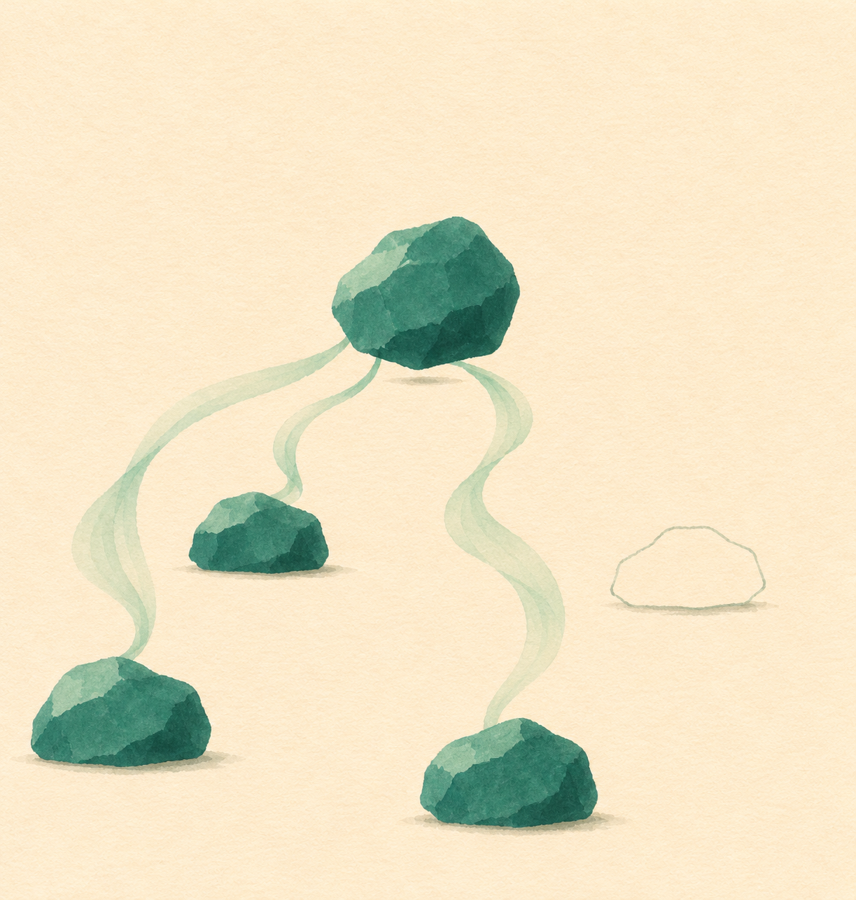
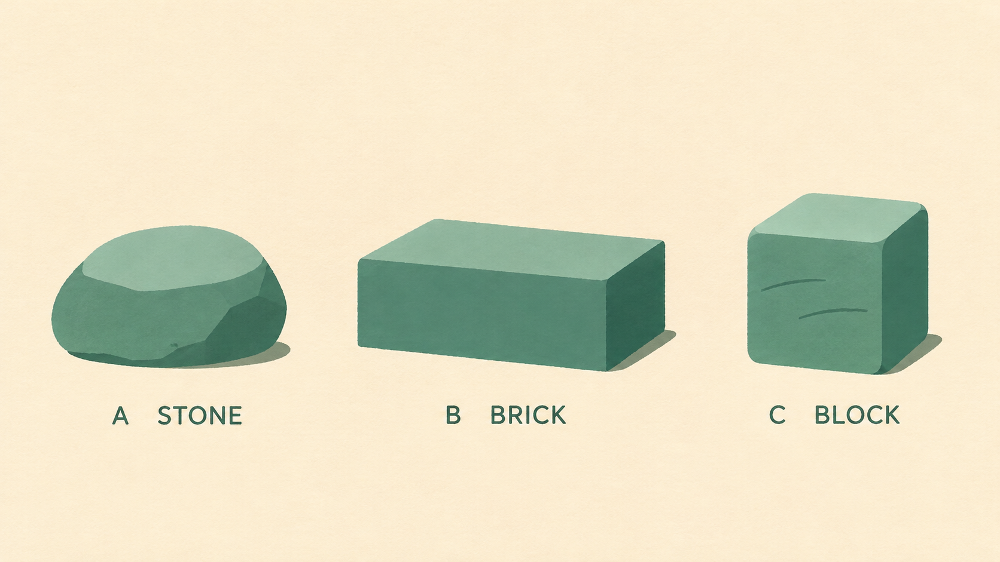

# Foundations in the party story

## Direction agreed November 21

Echo returns to his Version C hermit-crab body, violet faceted shell and raised coral claw. The claw expresses a commitment to accepting a starting point. Foundations get their own visual identity. The stone in the E = K machine is a temporary stand-in. Choose the new object before replacing the foundation illustrations across the canvas. Evan keeps his A1 fountain-pen design.

One object represents one claim being used as a starting point in this inquiry. Put the further belief it helps justify on a separate layer. A scene change can release one starting point while others stay in use. A released object can return in a later inquiry. For example, Simone can still recognize Evan’s signature after she starts doubting whether she read the full hour.

## Current preview · a floating cairn

Each belief is an irregular stone. Height shows its role in this inference. A supported stone can in turn support a further belief, so two visible levels suffice. Rotate the base ring until all four silhouettes have distinct positions. Three quiet trails of translucent mist rise from active foundations. The unused fourth keeps its outline and empty air above it.

Color the entire active arrangement, including the upper stone, for the context in view. Teal marks Simone’s situation as subject, rust marks Cole’s context as speaker, and blue marks Rae’s context as assessor. When comparing two views of the same belief, preserve its silhouette and caption. The tint identifies whose context matters to the account of justification. A blue rendering can still depict Simone’s belief. Whether Rae personally accepts its content is a separate story question. See Greco, §3, pp. 429–431.

## Initial material studies

Use one ordinary piece per starting point. A low flat stone echoes the current canvas, a brick makes stacking easy to read, and a wooden block has a softer toy-like shape. The flat stone is the recommended candidate. The choice is open.

Keep the silhouette consistent across the three routes. The E = K box can produce a piece for what Simone knows Evan wrote. In the hinge scene, a piece stays still while the characters investigate a different question. In the social scene, place a piece when the conversation reaches a premise the relevant group would take for granted.

Tint the piece teal for Simone, rust for Cole or blue for Rae when the view calls attention to that character’s context. Use a neutral tone for the general case. If a premise comes into doubt, fade its piece. When a scene needs to show what the premise supports, place the further claim just above it. Echo keeps his violet shell and uses his claw for endorsement.

## Four stones in a circle

Place four irregular stones around one floating stone, viewed from above at an angle. Keep all four positions visible when the inquiry changes. A solid stone sends a plume toward the upper belief while an unused starting point fades to an outline and its plume clears. The example shows three active foundations in Simone’s teal. Any of the four can come into or fall out of use. For Cole’s or Rae’s context, tint the active stones and their plumes rust or blue respectively.

Three concept studies explore how the support looks in depth. These earlier studies explored soft smog and visible mineral grains before the quieter cairn revision.

- [A · Soft mist](foundation-circle-soft-mist.png) pairs rounded river pebbles with curling watercolor smoke.
- [B · Mineral dust](foundation-circle-mineral-dust.png) uses chipped slate and streams of loose pigment.
- [C · Dust into smog](foundation-circle-dust-to-smog.png) starts each plume with grains at the foundation and lets them gather into a cloud against the floating belief.
