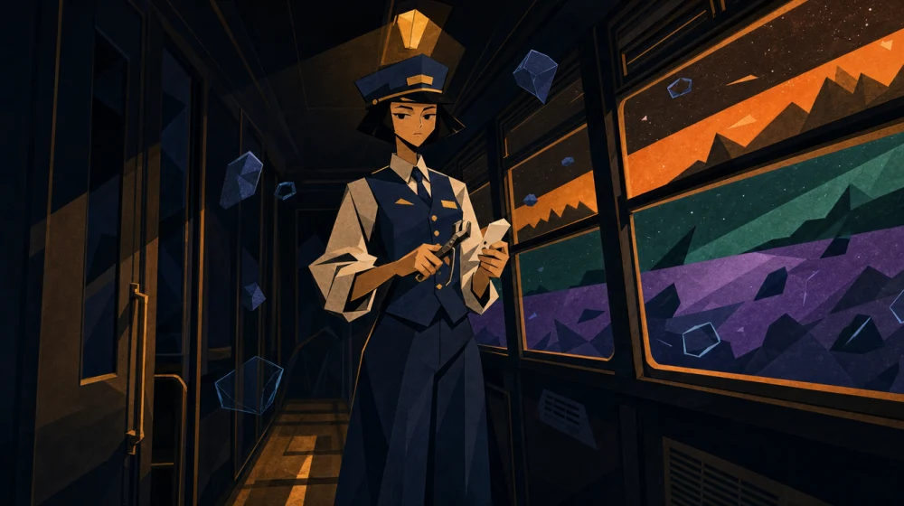
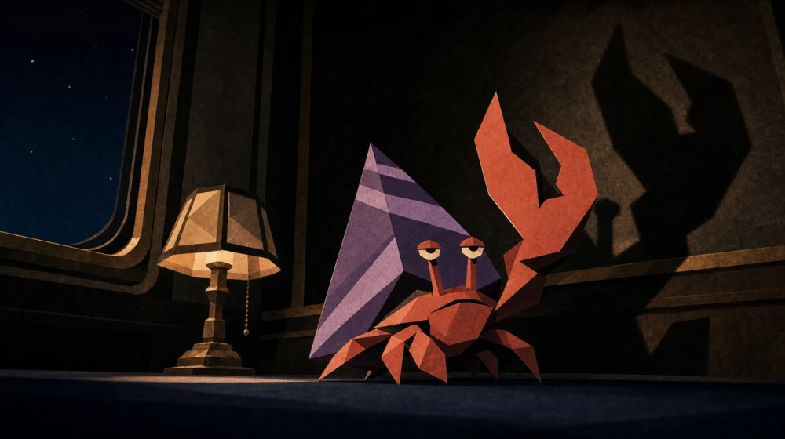
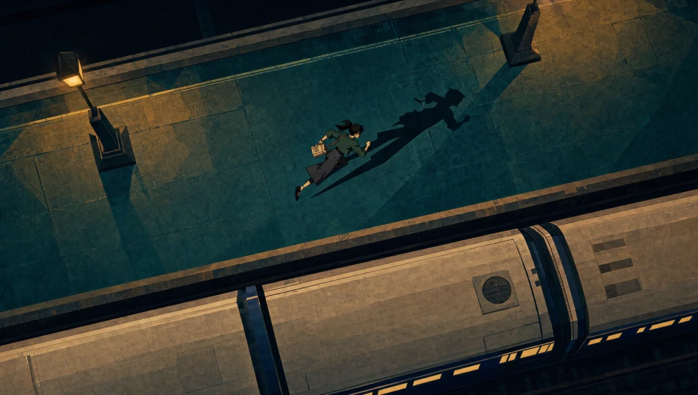

# The visual style of *Dead Ink*

Use this guide when drawing a new slide setting. The opening follows a student off a Unitrans bus and into the same classroom as the audience. By the time the story enters the past, the light and surroundings can change, but a chair leg in Giedt and a window frame on the train should still look like they were cut from the same paper.

## What belongs on the slide

### Fit the artwork to the page

Preserve the native aspect ratio of every presentation illustration and video. Center the entire frame in the space available and scale both axes together. A window narrower than the artwork gets bars above and below. A window wider than the artwork gets bars on the sides.

Use the same artwork bounds for the full-color establishing shot and its dialogue or speaker-focus frames. In a split view, fit each illustration to its own panel. The original paper and its margin notes float above the full slide. The paper can cover slide content. Keep the artwork, camera, canvas objects, portraits, transcripts, quizzes, and controls at the same size and position as the paper opens, closes, or resizes. Calculate their positions from the presentation viewport and keep paper measurements inside the overlay.

Reuse the shared `background-size: contain` rule in [style.css](../src/style.css) for slide backgrounds and use `object-fit: contain` for full-slide images and video. Use a uniform camera scale for canvas illustrations. Avoid `cover`, `fill`, and `100% 100%` for presentation artwork. Before adding a new page, preview it in a narrow window and a wide window. At each window size, compare the page with the paper closed, open, and resized. Check both the full-color and dialogue frames when the page has them.

### Dialogue-led presentation slides

Use one broad, dark dialogue box in the lower part of the slide. The [JumpFromPaper Classic 2D Series](https://jumpfrompaper.com/collections/classic-2d-series/) is the reference for bold ink outlines and offset blocks of flat color. Give the Ink Ocean box an indigo face, a gold inner rim, and a violet backing. Frame the room, portraits, and interactive examples above the box.

| Left half · what stays on the slide | Right half · what people say |
| --- | --- |
| Write the idea the audience should have in view throughout this section. Keep it fixed while the dialogue advances. Use a left-aligned claim, two concise bullets that connect the paper to the scene, and a compact reference to Greco. | Write the exchange one cue at a time. Use left-aligned serif text. Only this column scrolls. The active cue sits at its vertical center at full opacity. All other visible cues use the same reduced opacity. |

Start with equal column widths. Spacing, alignment, and type distinguish the columns without a center rule. In narrow panels, stack the mini-slide above the dialogue and reserve enough height to read the active turn. When navigation crosses a section boundary in either direction, update the statement and active turn together.

For example, the *Contemporary Contextualism* slide keeps “The same sentence can express different claims in different contexts” on the left while Professor Lin and the student work through the locked-door example on the right. To author a slide, put the fixed text in its `description` in [slide-content.ts](../src/slide-content.ts). Add spoken turns to the script in [classroom-dialogue.ts](../src/classroom-dialogue.ts), using the slide’s first member ID as each turn’s `scene`.

Show only the words of the dialogue in each visible transcript row. The centered line controls a bright outline on a visible speaker while the full scene stays in color. Use a silhouette rim on a transparent portrait and rounded corner marks around a painted speaker. Narration, offscreen voices, stage directions, and full-color establishing shots leave the artwork unmarked. Keep speaker names in accessible dialogue announcements. Update text emphasis and the outline together on scroll, click, keyboard navigation, reverse navigation, and shared cue changes.

The student speaks from the audience’s first-person viewpoint. Keep the classroom in full color during the student’s lines and narration. Place location or time captions on the scene.

For a new dialogue scene, check a long line at presentation and phone widths. Advance from one speaker to the other, then scroll back. Check that the highlighted words and speaker outline agree and that the dialogue box leaves the demonstration and faces visible. The Trial uses its dedicated courtroom cues and art.

| Part | Job | Classroom example |
| --- | --- | --- |
| **Canvas part** | Carries the idea the audience reads or manipulates. Keep the essential words and the interactive object together. | “Contemporary Contextualism” and the original ivory A and C tiles across, 12 and 14 tiles down, and one shared gold B/13 tile in the center. Professor Lin’s clickable portrait advances the dialogue at the bottom. |
| **Background part** | Establishes where and when the audience is. Make one landscape illustration with a quiet field behind the canvas part. Reveal the complete illustration when the camera reaches that slide. | Present-day Giedt Hall 1007, seen from the back left. The empty room leaves space for Professor Lin’s illustrated figure and the interactive tiles. |

## Reference pictures

**Rae in the carriage.** Look at the right-hand window. Its amber rim and three bands of distant color give the carriage depth. Toward the left the panels drop into one large navy shadow. Use that change in contrast to decide which parts of a room deserve attention.

**Echo by the lamp.** The raised coral claw reads first, the striped violet shell second. One crisp cast shadow ties them to the wall. The broad dark area carries a fine grain and very little other detail. Give a slide's interactive object this much room around its silhouette.

**The platform from above.** A strip of amber light separates the charcoal rails from the blue-green platform. Widely spaced posts and their angled shadows establish distance. Repeat a few recognizable shapes in perspective to describe a large room.

The first two samples come from the opening's approved Rae and Echo keyframes. The platform comes from the second opening cut. For a brighter interior and a recent example of how faces sit against a warm wall, use the hallway scene where Simone holds the invitation. [Hallway illustration](../src/assets/story/dead-ink/02-yyy-sowatt-asks-why.webp)

## Drawing the next setting

Use Flare for quick composition drafts when model selection is available. Switch to Sunburst once the composition is selected for final refinement. The first Giedt draft used built-in ImageGen, which did not report its variant.

1. **Start with the camera and three landmarks.** Name the viewpoint and identify the objects that would let someone recognize the location with all the signs removed. Draw near, middle and far shapes so they overlap. Carry the perspective through repeated objects such as desks, windows and light fixtures.
2. **Build with cut planes.** Give each major surface a flat base color and one shadow plane. Thin, angular rim highlights can separate an edge from a similar-colored surface. Let neighboring shapes define most outlines. Keep the paper tooth fine enough to disappear from across the classroom.
3. **Choose the light for the scene.** The night train gets ink navy and forest teal with small pools of amber. The classroom gets warm paper cream from the ceiling panels, charcoal-green boards, muted blue-gray chairs and a few ochre desk edges. Strong coral and amethyst usually identify Echo or a story clue. Preserve that association when choosing environmental accents.
4. **Compose around the live foreground.** Place strong architectural junctions outside the title and demonstration. Keep the central field low in detail. Board writing, explanatory text and B/13 tiles belong to the canvas. Preview with the real title visible, check the center mark against both axes, then check a narrow crop for seams crossing the lettering.
5. **Give each reference one job.** Supply the location photograph for geometry and one or two frames above for shape, light and surface. If a character appears in a later background, add their identity sheet separately. Review the new picture alongside its references at thumbnail size before adding it to this guide.

For the recurring cast, use Simone's black loop ponytail and green jacket, Cole's rust jacket and phone, Rae's navy cap and ticket punch, Echo's tall striped shell and one oversized coral claw, and Evan's indigo pen barrel and gold nib. Their acting also distinguishes them. Simone notices with a small glance, Cole turns toward an audience with open energy, Rae's level gaze holds while the punch moves, Echo's half-lidded eyes stay still as the claw gives its verdict, and Evan bows to write. Use the bible's selected sheet panels for any named character. [Character bible and identity references](character-bible.md#reference-image-rules)

## Opening · Unitrans arrival

A student with a backpack steps off the bus and looks down the campus path toward lecture. The caption “UC Davis · Present day” establishes the time before the later flashback. Use the red-and-ivory body, dark windows and pale rooftop housing from the photograph of bus 4020 on the cover of the official T Line guide. The campus path is an illustrated setting. [Unitrans vehicle reference](https://unitrans.ucdavis.edu/sites/g/files/dgvnsk13431/files/media/documents/T-Line2025-26_English_0.pdf#page=1) · [Opening artwork](../public/generated/backgrounds/dead-ink/00-unitrans-arrival.webp)

## Classroom · Giedt Hall 1007

Frame the rows of tablet-arm chairs from the rear-left corner. The teaching station sits at front left. Dark sliding chalkboards run across the front and onto the right wall, beneath a grid of rectangular ceiling lights. The ceiling-mounted projector sits about one-third of the room width in from the right, aimed toward the central front board. Use the architecture and daylight values to establish the present day. The classroom stays on screen long enough for the audience to watch the same gold mark change readings. [UC Davis room photograph](https://local-resources.ucdavis.edu/local_resources/images/room-lookup/Giedt%20Hall_1007_backleft.jpg) · [Slide background](../public/generated/backgrounds/dead-ink/01-giedt-classroom.webp)

### Presenter cue

Generation prompt for the first classroom draft

Create a single wide 16:9 full-bleed 2D animation background painting of present-day Giedt Hall 1007. First reference is the actual room: keep its recognizable back-left view into the corner, banks of double-height sliding dark chalkboards on both walls in pale vertical frames, ceiling tile perspective grid with rectangular luminous panels, suspended projector, black teaching station left and orderly rows of light gray individual tablet-arm chairs. Second and third references are the Dead Ink opening's art direction only: translate the architecture into the same sophisticated angular cut-paper animation still, crisp silhouettes, overlapping planes of matte ink, subtle irregular printed paper grain, one or two deliberately faceted shadows per form, selective amber edge light against ink navy and petrol teal. A sunlit, matter-of-fact contemporary university interior, inviting warm cream ceiling panels and desks, quieter chalkboard middle. Set camera low enough that the boards form a generous uninterrupted dark horizontal band through the middle, with the nearest, most detailed chairs pushed to bottom corners. A real room, cinematic editorial composition. Empty classroom, blank boards. Zero people, crabs, trains, magic, lettering, numerals, tile diagrams, captions, screen controls or browser UI. The title and interactive tiles are added in the app. Deliver just the landscape artwork, with opaque edges.

*Give the definition, then show the shared mark.* Ask “What do you see there?” In Editor and Audience views, offer B and 13 as two independent vinyl records in the upper-right corner. Both turquoise rims shrink around their circumference over ten seconds while the classroom stays in full color. The question stays in the transcript. Both choices lead to Professor Lin’s flashback line. Read across the mark for A, B, C and down for 12, 13, 14. Hover or keyboard focus fades the single center tile in and out. Reduced motion keeps it visible.

In the local preview, the flashback line keeps the two records on screen. Each turquoise arc now represents that answer’s share of submitted audience votes. A gold rim marks the leader; a tie leaves both records equally emphasized. An unanswered timeout contributes no ballot. Editor previews read the same tally. Each audience browser can replace its own vote by replaying the quiz. Restarting the local Vite server starts a fresh tally.

*Lead into the flashback.* Give Professor Lin’s post-quiz response its own cue. Follow it with the line about the chalk, then keep Professor Lin in the classroom for the final cue, “Flexible foundationalism.” [Greco, introduction, p. 425](../public/readings/greco-2017.pdf#page=1)

*Play the opening.* In local Presenter view, advancing from the last classroom cue plays the staged Codex V2 cut fullscreen. The video starts loading during the intro. Connected Audience views show black while the opening plays. The end of the video advances to The Law of Ink. Page Down skips the opening and Escape returns to the classroom cue. The current player serves the private `op/drafts/dead-ink-op-codex-v2.mp4` from the course workspace.
