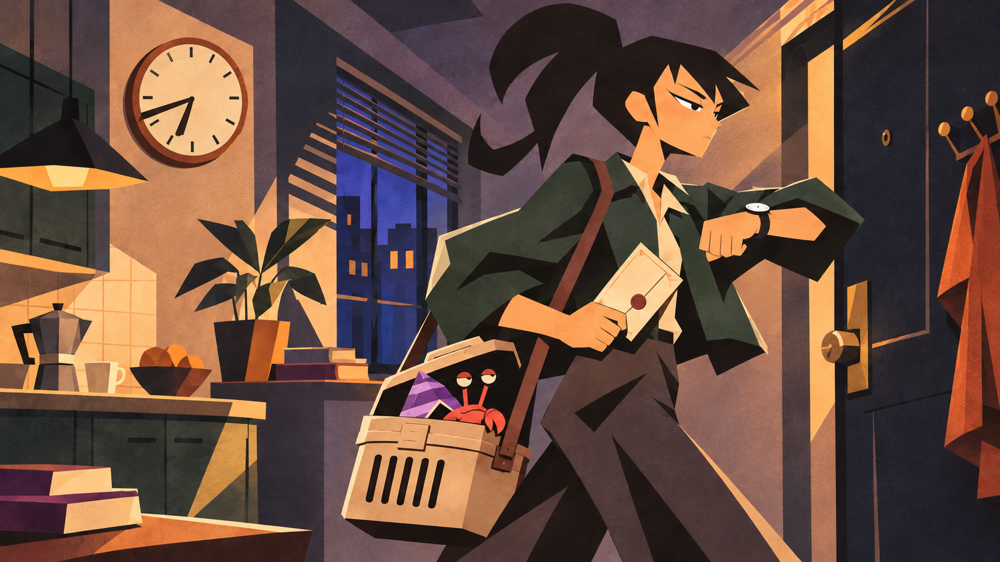
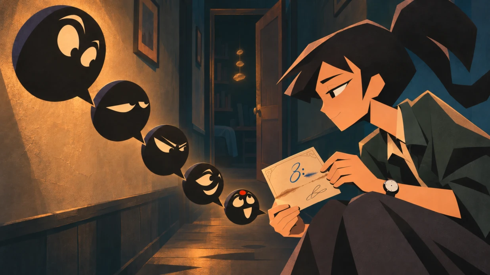
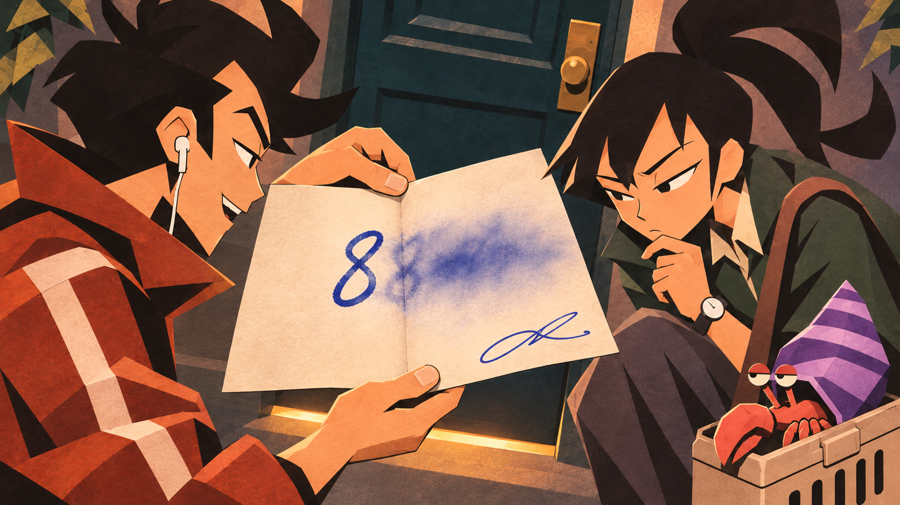

# PHI 102 story illustrations

See the [current seven-frame storyboard](current/README.md) for the sequence drawn from the Version C model sheets.

Keyframes generated with built-in ImageGen using the approved Version C character designs. [Read the current story](../story-and-characters.md).

Frame 6 shows the current signed-invitation reveal. The earlier shell-switch and doorway frames are kept below for reference. The current ending uses [Evan’s approved A1 fountain-pen design](../character-references/evan-a1-courteous-scribe.png).

## Giedt Hall 1007 scene reference

Mount the projector on the ceiling near the back of the room. From the back looking toward the chalkboards, place it about one-third of the room’s width in from the right wall. Aim it toward the pull-down screen over the middle front chalkboard.

[Rear-left room photo](https://local-resources.ucdavis.edu/local_resources/images/room-lookup/Giedt%20Hall_1007_backleft.jpg) · [Front-left room photo](https://local-resources.ucdavis.edu/local_resources/images/room-lookup/Giedt%20Hall_1007_frontleft.jpg) · [Front wall with the screen lowered](https://joongwlee.wordpress.com/2010/10/01/acts-2-fellowship-a2f-uc-davis/)

## 1. A crab on a deadline



Simone checks her watch and heads out with Echo and the sealed invitation.

## 2. YYYY SOWATT asks why



Simone lowers the invitation so the smallest voice can see the loop in Evan’s signature.

## 3. The 7:12 from platform 3


The trainspotters scrutinize the invitation as Simone finds the 7:12 on the departure board.

## 4. Cole makes the claim


Cole says Simone is justified. Simone listens, Rae sizes up the claim, and Echo keeps his claws down.

## 5. Punch and claw


Rae punches the ticket as Echo raises a claw.

## 6. The ink smudge



Simone recognizes Evan’s looping blue signature. The ink transferred across the fold, and she can no longer tell whether she read the whole time.

## Earlier frame 6. The shell switch


Cole replays Evan’s voice memo, Simone turns to the email, and Echo leaves his old shell behind.

## Earlier frame 7. You’re early


Evan opens the door with a mouthful of cake. Echo clacks once from his new shell.

> **Before writing a new prompt:** the prompts below predate the [character bible](../character-bible.md). They describe identity but not acting, which is why some frames show Simone sulking and Rae scowling. For new frames, add each character's acting block from the bible and follow its reference-image rules.

## ImageGen prompts

<details>
<summary>Show the prompts with current cast names</summary>

### 1. A crab on a deadline

```text
Use case: illustration-story. Generate ONE new standalone landscape storyboard illustration, ideally 16:9, and one full-bleed composition per request. This is part of a single seven-frame story. Art direction: the precise illustrated character model-sheet style carried into a designed cinematic environment, angular cut-paper shapes with textured matte ink, long stylized adult silhouettes, flat two-tone faceted shadows, economical expressive faces, crisp geometric props and restrained paper grain. Each recurring person must match the face, hairstyle, costume, and color of the corresponding attached identity sheet. Sheets are design references only; do not repeat their grids, poses literally, reference labels, pale backdrop, or any old character name. A restrained palette of ink navy, forest green, brick rust, warm amber, paper cream, and amethyst. Mature deadpan comedy with cinematic light, bold silhouettes, and a clear gaze or gesture. No watermarks, graphic frame, borders, title, or collage. Render only the actions and lettering requested for this shot.

Input character identity sheets in the order attached:
1. Simone (sheet labeled JUSTINE) has a high black loop ponytail and sharp bangs, forest-green cropped jacket, cream shirt, wide charcoal trousers, dark wristwatch, and boxy tan vented crab carrier on a brown shoulder strap. She is practical and deadpan.
2. Echo (sheet labeled GUS) is a palm-sized coral-red hermit crab with two half-lidded ivory stalk eyes, one oversized angular claw, and a very recognizable tall asymmetric violet pyramid-like crystal shell with lavender bands and a dark triangular opening. Match his dry expression and shape.

Scene: Opening keyframe at 6:41 inside a modest apartment by the front door. Wide dynamic medium shot, diagonal motion through the apartment as Simone checks the wristwatch on her left wrist and holds a cream invitation with a small red seal in her right. The lid of the tan travel carrier is ajar just enough for one small Echo to peer out, both eye stalks and purple shell visible. A warm kitchen clock on the wall provides the sense of time without carrying the focus. Late-evening cobalt begins outside the window. Play the mundane mission with the visual gravity of a thriller.
```

### 2. YYYY SOWATT asks why

Use Simone’s Version C identity sheet and YYYY SOWATT’s single-tail sheet. Frame Simone on the right in the amber-lit hallway, holding Evan’s invitation. On the left, five ink bubbles descend toward the card. Each tail points toward the next voice until the smallest, marked red, points at the invitation and asks its question. Simone answers with a patient half-smile. Keep the blue eight, the smear and the looping signature visible.

### 3. The 7:12 from platform 3

```text
Use case: illustration-story. Generate ONE new standalone landscape storyboard illustration, ideally 16:9, and one full-bleed composition per request. This is part of a single seven-frame story. Art direction: the precise illustrated character model-sheet style carried into a designed cinematic environment, angular cut-paper shapes with textured matte ink, long stylized adult silhouettes, flat two-tone faceted shadows, economical expressive faces, crisp geometric props and restrained paper grain. Each recurring person must match the face, hairstyle, costume, and color of the corresponding attached identity sheet. Sheets are design references only; do not repeat their grids, poses literally, reference labels, pale backdrop, or any old character name. A restrained palette of ink navy, forest green, brick rust, warm amber, paper cream, and amethyst. Mature deadpan comedy with cinematic light, bold silhouettes, and a clear gaze or gesture. No watermarks, graphic frame, borders, title, or collage. Render only the actions and lettering requested for this shot.

Input character identity sheets in the order attached:
1. Simone (sheet labeled JUSTINE) has a high black loop ponytail and sharp bangs, forest-green cropped jacket, cream shirt, wide charcoal trousers, dark wristwatch, and boxy tan vented crab carrier on a brown shoulder strap. She is practical and deadpan.
2. Cole (sheet labeled KIT) has swept angular black hair, a high-collared rust-orange jacket with cream sleeve stripes, black clothes and wired earbuds. He carries a landscape phone on a short selfie grip with a tiny warm ring light. He is an animated livestreamer.
3. Echo (sheet labeled GUS) is a palm-sized coral-red hermit crab with two half-lidded ivory stalk eyes, one oversized angular claw, and a very recognizable tall asymmetric violet pyramid-like crystal shell with lavender bands and a dark triangular opening. Match his dry expression and shape.

Scene: Night train platform, single wide three-quarter composition at the train door. Simone has the invitation in hand and looks up at a retro amber LED departure board while Cole films beside her with his ring-light phone. In the same space a small pair of supporting trainspotters in muted raincoats glance skeptically at the invitation, secondary to the named characters. Echo is visible just above the rim inside Simone’s tan carrier. Deep navy and forest-green station, gold lighting, old cream-and-navy train, a clean diagonal of the platform. The overhead departure board has exactly one readable row, verbatim ‘7:12   PLATFORM 3’, large and legible. No other lettering.
```

### 4. Cole makes the claim

```text
Use case: illustration-story. Generate ONE new standalone landscape storyboard illustration, ideally 16:9, and one full-bleed composition per request. This is part of a single seven-frame story. Art direction: the precise illustrated character model-sheet style carried into a designed cinematic environment, angular cut-paper shapes with textured matte ink, long stylized adult silhouettes, flat two-tone faceted shadows, economical expressive faces, crisp geometric props and restrained paper grain. Each recurring person must match the face, hairstyle, costume, and color of the corresponding attached identity sheet. Sheets are design references only; do not repeat their grids, poses literally, reference labels, pale backdrop, or any old character name. A restrained palette of ink navy, forest green, brick rust, warm amber, paper cream, and amethyst. Mature deadpan comedy with cinematic light, bold silhouettes, and a clear gaze or gesture. No watermarks, graphic frame, borders, title, or collage. Render only the actions and lettering requested for this shot.

Input character identity sheets in the order attached:
1. Cole (sheet labeled KIT) has swept angular black hair, a high-collared rust-orange jacket with cream sleeve stripes, black clothes and wired earbuds. He carries a landscape phone on a short selfie grip with a tiny warm ring light. He is an animated livestreamer.
2. Simone (sheet labeled JUSTINE) has a high black loop ponytail and sharp bangs, forest-green cropped jacket, cream shirt, wide charcoal trousers, dark wristwatch, and boxy tan vented crab carrier on a brown shoulder strap. She is practical and deadpan.
3. Rae (sheet labeled JO) has an angular black bob, navy cap with thin gold band, navy vest with brass buttons and cream rolled sleeves, wide navy trousers, and actual metal ticket-punch pliers. She is imperturbable.
4. Echo (sheet labeled GUS) is a palm-sized coral-red hermit crab with two half-lidded ivory stalk eyes, one oversized angular claw, and a very recognizable tall asymmetric violet pyramid-like crystal shell with lavender bands and a dark triangular opening. Match his dry expression and shape.

Scene: Inside the same moving night train, wide medium composition framed against a long indigo window with lights sliding past. Cole in rust is the active speaker at the left, leaning toward the camera of his ring-light phone with a raised explanatory hand. Simone in green sits opposite with the cream invitation flat in one hand, skeptical and patient as the subject of his confident claim. Rae in her navy-and-gold conductor uniform appears in the aisle at right, appraising what she has just overheard, punch pliers relaxed at her side. Echo is palm-sized, visible at the lip of the carrier on Simone’s seat, both claws lowered. Keep everyone recognizable and give each a distinct eyeline. No floating labels, verbal bubbles, or captions.
```

### 5. Punch and claw

```text
Use case: illustration-story. Generate ONE new standalone landscape storyboard illustration, ideally 16:9, and one full-bleed composition per request. This is part of a single seven-frame story. Art direction: the precise illustrated character model-sheet style carried into a designed cinematic environment, angular cut-paper shapes with textured matte ink, long stylized adult silhouettes, flat two-tone faceted shadows, economical expressive faces, crisp geometric props and restrained paper grain. Each recurring person must match the face, hairstyle, costume, and color of the corresponding attached identity sheet. Sheets are design references only; do not repeat their grids, poses literally, reference labels, pale backdrop, or any old character name. A restrained palette of ink navy, forest green, brick rust, warm amber, paper cream, and amethyst. Mature deadpan comedy with cinematic light, bold silhouettes, and a clear gaze or gesture. No watermarks, graphic frame, borders, title, or collage. Render only the actions and lettering requested for this shot.

Input character identity sheets in the order attached:
1. Rae (sheet labeled JO) has an angular black bob, navy cap with thin gold band, navy vest with brass buttons and cream rolled sleeves, wide navy trousers, and actual metal ticket-punch pliers. She is imperturbable.
2. Echo (sheet labeled GUS) is a palm-sized coral-red hermit crab with two half-lidded ivory stalk eyes, one oversized angular claw, and a very recognizable tall asymmetric violet pyramid-like crystal shell with lavender bands and a dark triangular opening. Match his dry expression and shape.
3. Cole (sheet labeled KIT) has swept angular black hair, a high-collared rust-orange jacket with cream sleeve stripes, black clothes and wired earbuds. He carries a landscape phone on a short selfie grip with a tiny warm ring light. He is an animated livestreamer.
4. Simone (sheet labeled JUSTINE) has a high black loop ponytail and sharp bangs, forest-green cropped jacket, cream shirt, wide charcoal trousers, dark wristwatch, and boxy tan vented crab carrier on a brown shoulder strap. She is practical and deadpan.

Scene: Same moving train, close medium low-angle table-level keyframe, a deadpan clash. On one side Rae calmly squeezes black ticket-punch pliers onto the edge of a small cream paper ticket with exactly the legible stamped words ‘NOT VALID’. On the other side Echo planted beside the open tan carrier raises his one large red claw as a clear counter-gesture, the violet banded shell and indifferent eye stalks instantly legible. Make the punch and claw the two main silhouettes. Only if in frame, Simone in green and Cole in rust are visibly separate reactions at the edges, quieter than Rae and Echo. Echo is palm-sized, made visually prominent by perspective, one crab only. A warm compartment lamp, blue-black train window. No other lettering.
```

### 6. The shell switch

```text
Use case: illustration-story. Generate ONE new standalone landscape storyboard illustration, ideally 16:9, and one full-bleed composition per request. This is part of a single seven-frame story. Art direction: the precise illustrated character model-sheet style carried into a designed cinematic environment, angular cut-paper shapes with textured matte ink, long stylized adult silhouettes, flat two-tone faceted shadows, economical expressive faces, crisp geometric props and restrained paper grain. Each recurring person must match the face, hairstyle, costume, and color of the corresponding attached identity sheet. Sheets are design references only; do not repeat their grids, poses literally, reference labels, pale backdrop, or any old character name. A restrained palette of ink navy, forest green, brick rust, warm amber, paper cream, and amethyst. Mature deadpan comedy with cinematic light, bold silhouettes, and a clear gaze or gesture. No watermarks, graphic frame, borders, title, or collage. Render only the actions and lettering requested for this shot.

Input character identity sheets in the order attached:
1. Simone (sheet labeled JUSTINE) has a high black loop ponytail and sharp bangs, forest-green cropped jacket, cream shirt, wide charcoal trousers, dark wristwatch, and boxy tan vented crab carrier on a brown shoulder strap. She is practical and deadpan.
2. Cole (sheet labeled KIT) has swept angular black hair, a high-collared rust-orange jacket with cream sleeve stripes, black clothes and wired earbuds. He carries a landscape phone on a short selfie grip with a tiny warm ring light. He is an animated livestreamer.
3. Echo (sheet labeled GUS) is a palm-sized coral-red hermit crab with two half-lidded ivory stalk eyes, one oversized angular claw, and a very recognizable tall asymmetric violet pyramid-like crystal shell with lavender bands and a dark triangular opening. Match his dry expression and shape.

Scene: Outside Evan’s apartment after the train. Single unified close keyframe at the threshold from a slight high angle, warm sliver of light under a dark teal door behind. Cole in rust holds his phone toward Simone, a stylized simple orange voice waveform on the display. Simone looks down thoughtfully and brings a crisp cream email screen on her own phone into view, recognizable by a small envelope icon with a few clean unreadable lines. Crucially at the bottom foreground on the threshold, one small coral Echo is midway into a new, subtly lighter violet faceted shell to the right. His own broad claw, half-lidded eye stalks and coral body make it plainly the same individual. His visibly hollow old tall lilac-striped shell sits empty behind him on the left. Clearly show one crab and two distinct shells. Draw the phones as meaningful parts of the scene, no legible text. Thoughtful mood and dry humor.
```

### 7. You’re early

```text
Use case: illustration-story. Generate ONE new standalone landscape storyboard illustration, ideally 16:9, and one full-bleed composition per request. This is part of a single seven-frame story. Art direction: the precise illustrated character model-sheet style carried into a designed cinematic environment, angular cut-paper shapes with textured matte ink, long stylized adult silhouettes, flat two-tone faceted shadows, economical expressive faces, crisp geometric props and restrained paper grain. Each recurring person must match the face, hairstyle, costume, and color of the corresponding attached identity sheet. Sheets are design references only; do not repeat their grids, poses literally, reference labels, pale backdrop, or any old character name. A restrained palette of ink navy, forest green, brick rust, warm amber, paper cream, and amethyst. Mature deadpan comedy with cinematic light, bold silhouettes, and a clear gaze or gesture. No watermarks, graphic frame, borders, title, or collage. Render only the actions and lettering requested for this shot.

Input character identity sheets in the order attached:
1. Simone (sheet labeled JUSTINE) has a high black loop ponytail and sharp bangs, forest-green cropped jacket, cream shirt, wide charcoal trousers, dark wristwatch, and boxy tan vented crab carrier on a brown shoulder strap. She is practical and deadpan.
2. Cole (sheet labeled KIT) has swept angular black hair, a high-collared rust-orange jacket with cream sleeve stripes, black clothes and wired earbuds. He carries a landscape phone on a short selfie grip with a tiny warm ring light. He is an animated livestreamer.
3. Echo (sheet labeled GUS) is a palm-sized coral-red hermit crab with two half-lidded ivory stalk eyes, one oversized angular claw, and a very recognizable tall asymmetric violet pyramid-like crystal shell with lavender bands and a dark triangular opening. Match his dry expression and shape.

Scene: Wide medium reverse shot at the same now-open teal apartment doorway, warm gold party lighting pouring into the blue hall. Evan, an unassuming supporting host with soft short dark-brown hair, a cream shirt and an understated brown apron, is caught chewing cake with a fork in one hand and a small plate in the other. Simone in her characteristic green jacket and high loop ponytail gives him a frozen deadpan look. Cole in rust momentarily lowers his phone with a stunned expression. The star of the punchline is palm-sized Echo at the front of his open tan carrier, with his lighter faceted violet replacement shell from the scene at the threshold, raising one claw with the same half-lidded air. A few soft-focus celebrating guests and simple party bunting are visible behind Evan. Make the joke readable from body language alone. No type or speech bubbles.
```

### Final frame continuity edit

```text
Use case: precise-object-edit. Image 1 is the target, the finished party doorway frame where Evan is chewing cake. Image 2 is a continuity reference, the preceding scene at the closed green door. The single edit: in Image 1, replace the tall striped triangular purple shell BEHIND the red hermit crab IN THE CARRIER at bottom left with his new shell from Image 2, the squat rounded faceted light lavender amethyst crystal to the right of the old empty pyramid. Match the new shell's compact asymmetric gem silhouette and polygonal facets, with no horizontal stripes. Seat it convincingly on Echo's back, in the same lower-left carrier behind his body. Keep Echo's red body, raised red claw, eye stalks and deadpan expression visibly identical. The tall striped shell was left behind and should be absent from this image. Keep the whole rest of Image 1 unchanged, including crop, poses and faces, room, party guests, clothes, color, lighting, perspective and texture. No added text. Return exactly one 16:9 cinematic cut-paper illustration.
```

### 6. The ink smudge

```text
Use case: illustration-story. Update the attached storyboard keyframe for the current PHI 102 story, as one clean 16:9 full-bleed landscape illustration. The attachment is the older scene to adapt. Preserve its angular cut-paper art direction, matte ink texture, character likenesses and costumes, nighttime entryway with dark teal numberless door and amber light at the sill, navy/rust/forest green/amethyst palette, and restrained deadpan mood. Reframe closer from a slight high angle, with the paper at the visual center and the characters' faces framing it. Make their eyelines converge on the paper.

The new beat: Cole, left, rust jacket with cream sleeve stripes and black swept hair, stretches open a fairly large cream, once-folded party invitation between him and Simone at the closed door. His phone is lowered out of shot. We look at the inside of the card, clearly seeing a sharp physical center crease. In large handwritten cobalt blue near the crease is a single readable numeral “8”. Immediately after the 8 there is a small distinct mirrored blue ink transfer and a blurred pool across the crease that could hide further digits. Keep anything beyond that 8 entirely illegible; save the actual time for the next frame. Near the lower corner is a distinctive crisp looping blue signature flourish without readable letters. Simone, right, wearing her forest-green jacket and high black loop ponytail, leans toward the card and scrutinizes the smudge with one raised eyebrow; her watch is visible and she's empty-handed. Make the paper large and bright enough that the eight, fold, blue transfer and distinct signature can all be read at a glance. Carry the eye from Simone’s face to the card and ink. At bottom right, one palm-sized coral hermit crab Echo peers from the lip of his tan vented shoulder carrier: half-lidded eye stalks, one big coral claw and his ORIGINAL tall asymmetric pointed violet shell with lavender bands, fully on his back. Exactly one shell, the original tall striped violet shell, and exactly one crab. Evan is on the other side of the closed door. The scene should only depict the tangible invitation discovery; do not introduce a visual foundation prop. No other people, phone graphics, superimposed text, captions, panels, or watermarks.
```

</details>
