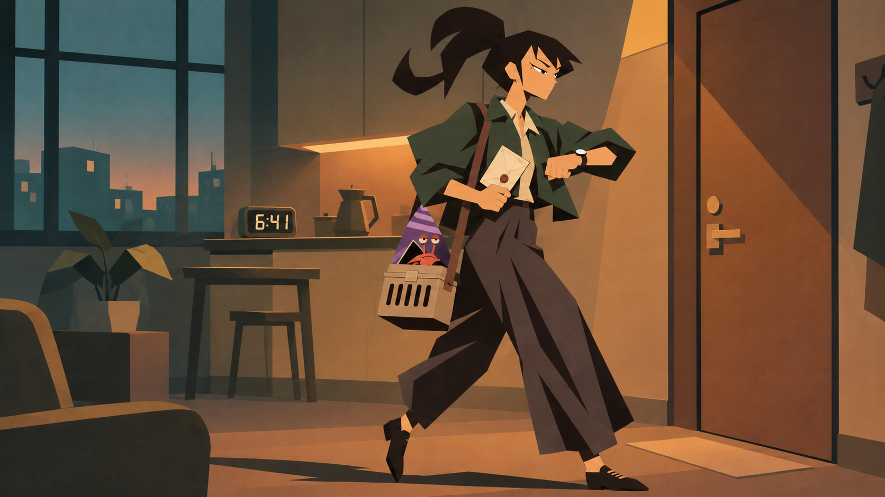
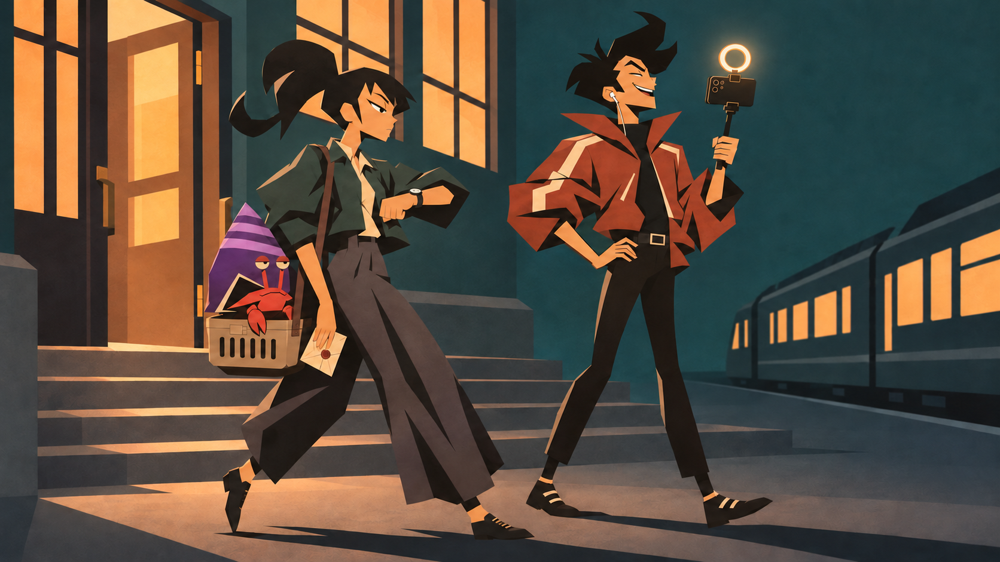
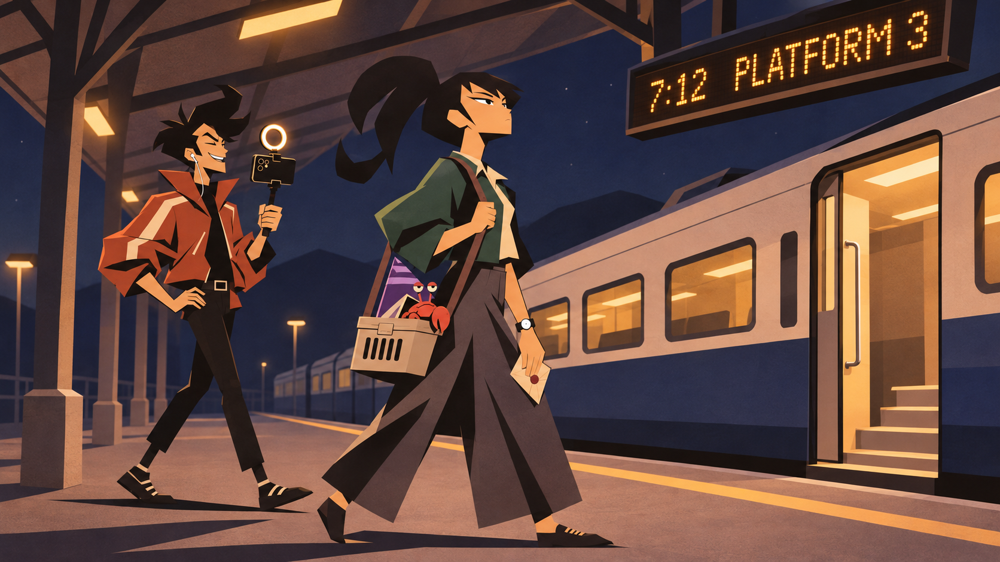
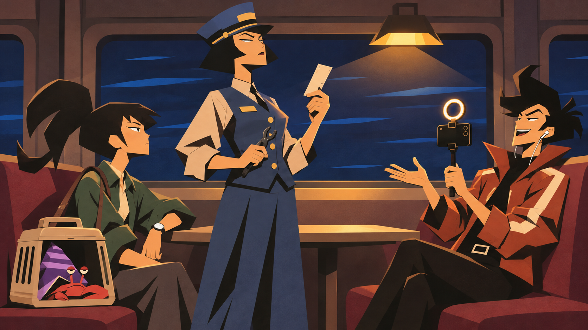
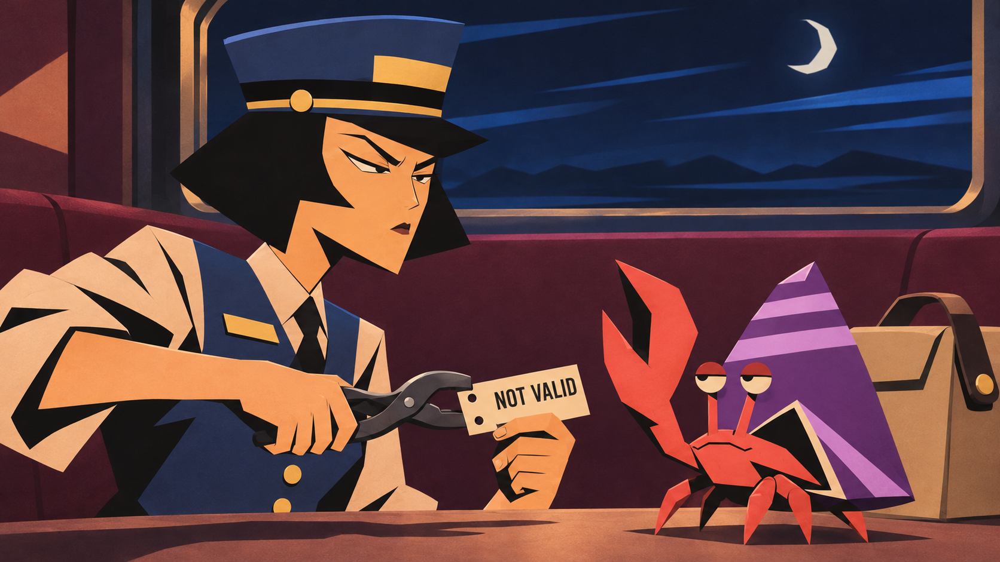
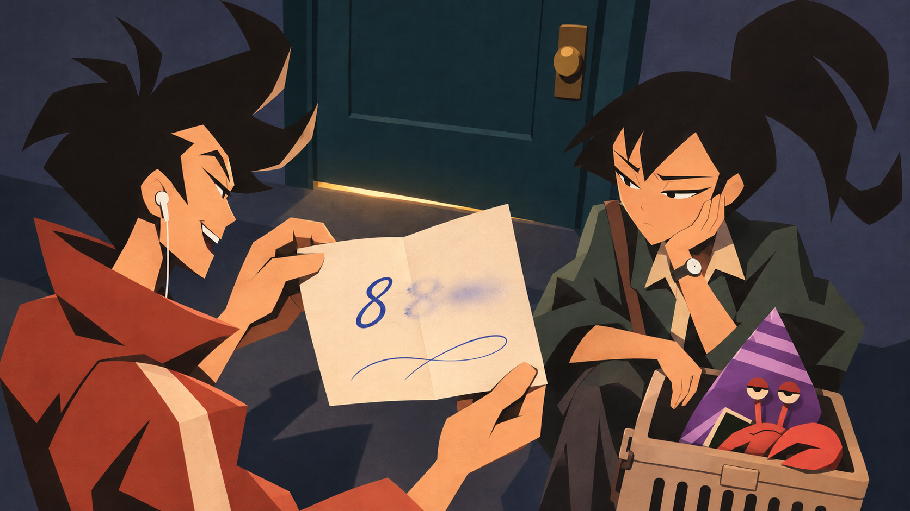
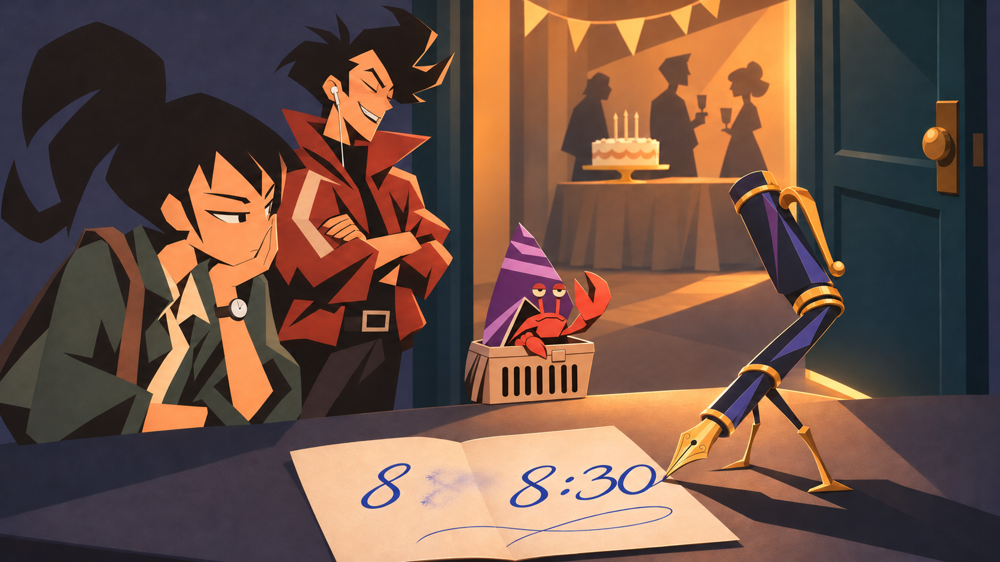

# PHI 102 storyboard

Seven frames illustrated in story order with built-in ImageGen using the [Version C model sheets](../../character-references/version-c/Version%20C%20-%20Character%20Model%20Sheets.pdf) and [Evan’s approved fountain-pen design](../../character-references/evan-a1-courteous-scribe.png). [Read the story](../../story-and-characters.md).

## 1. Simone and Echo



At 6:41, Simone checks the time and gets ready to leave with Echo and Evan’s invitation.

## 2. Cole joins the trip



Cole meets Simone outside and starts livestreaming the trip.

## 3. The 7:12 from platform 3



At the station, Simone reads the departure board and heads for the 7:12 from platform 3.

## 4. Rae checks the ticket



Onboard, Rae checks Simone’s ticket while Cole tells his stream that Simone is justified in taking the invitation at its word.

## 5. Punch and claw



Rae punctuates her disagreement with a ticket that reads “NOT VALID.” Echo raises one claw.

## 6. The ink smudge



Cole unfolds the invitation. Simone recognizes Evan’s blue signature and sees where wet ink transferred after the eight.

## 7. You’re early



The guests surprise Echo. Evan bows over the invitation, writes 8:30, and tells Simone she’s early.

## Generation prompts

<details>
<summary>Show prompts and image references</summary>

Each frame prompt combines the shared direction, its image-reference instructions, and its shot description.

### Shared direction

```text
Adapt the supplied approved Version C model-sheet drawings into ONE continuous, full-bleed widescreen 16:9 narrative illustration in the same character-design and animation style. The input drawings are locked identity and costume sources. Place one instance of each specified character in the scene. Preserve the exact head silhouette, hair outline, eye design, jaw and nose, facial construction, anatomical proportions, clothing pattern, props and colors as if the model-sheet artist posed the same puppets. Adapt the posing and composition only as the action requires. Carry the sheet's broad angular shapes, matte color areas, two-tone faceted shadow, subtle paper texture and long stylized silhouettes into a cinematic night setting. Make each face clearly readable in three-quarter or side view. Render straight from the drawings and preserve their minimal facial marks. Preserve even small details such as watch, cuffs, collars and bag strap. Backgrounds should be simpler and quieter than the characters and leave their silhouettes clear. The sheet's legacy name, repeated poses, sheet background, labels and layout should disappear. No added design details, heavy texture, speech bubbles, overlays, border or watermarks.
```

### 1. Simone and Echo

```text
Image 1 is Simone. Use her lower-left watch-checking acting pose and upper-left walking drawing as the primary guide to the exact face, hair and outfit. Her ponytail is a solid large bent sweep with a tapered upturned tail, matching the sheet's silhouette. Preserve her long, narrow, slanted eyes, sharp nose, pale shirt collar against dark green, wide charcoal trousers, vented tan carrier worn low on a brown shoulder strap, and round white-faced watch. Image 2 is Echo. Use the lower middle resting pose: very small coral crab, low angular claw, exact flat-sided triangular purple shell with two light stripes, black triangular opening with light trim, both half-lidded eyes, no extra appendages.

In the apartment at dusk, Simone stops near the front door to check her left wristwatch. Opposite hand holds Evan's folded cream invitation from the outside, with its small round red seal on the flap. Echo looks out of the low carrier, utterly still. A legible digital kitchen clock in the background reads “6:41”. Frame from a medium-wide three-quarter angle, with Simone large in the picture and her entire head, hair, carrier, and at least three quarters of her silhouette visible. Muted teal window, amber apartment light, economical layered background. Simone and Echo are alone. The only legible text is the clock.
```

### 2. Cole joins the trip

```text
Image 1 is Simone. Preserve her exact large swept ponytail, slanted eyes, small sharp nose, green cropped jacket and dramatic wide charcoal trousers. Image 2 is Echo. Use his low-claw pose with the precise triangular banded shell and unimpressed cream stalk eyes. Image 3 is Cole. Match his very tall, hooked swept forelock with two sharp forward horns, thin long proportions, narrow right-angle jaw and sharp eyebrows, exaggerated pointed rust collar, SINGLE cream band down each sleeve, black high-neck top, straight slim trousers, white earbud, landscape ring-light phone on a short black stick.

The building's outdoor steps at night. Simone has only just come through the front door with the folded cream invitation and Echo in his tan carrier at her hip. Cole joins her from the sidewalk and clicks on his ring-light phone, greeting his livestream with the exact cocked grin and sideways expression from his model sheet. She gives his camera a skeptical sideways glance as she steps past him toward the train. A full-figure dynamic medium-wide two-shot with the exact sheet silhouettes against a plain teal nighttime wall and warm window light. Simone, Cole, and Echo only. No legible text.
```

Follow-up edit

```text
One precise correction to this full-bleed 16:9 storyboard frame. Simone, the woman on the left in the olive-green jacket, has exactly one watch. Remove the duplicate round white-faced wristwatch from her lowered hand that holds the cream envelope. That lowered forearm and wrist are bare from the jacket cuff to her hand. Keep the circular watch on the raised forearm in front of her chest. Preserve that raised arm's pose and her lowered arm and hand and invitation pose. Preserve all other pixels and visual content to the extent possible, including crop, composition, background, light, colors, faces, hair silhouettes, costumes, Cole’s phone and fingers, Echo and his carrier.
```

### 3. The 7:12 from platform 3

```text
Image 1 is Simone. Use the long thoughtful profile from the lower middle and exact wide-trouser silhouette. Image 2 is Cole. Preserve the swept tall hooked hair, wiry outline, pointed jacket collar, earbuds, and landscape phone on grip. Image 3 is Echo, in his exact resting pose and pointed banded shell, palm-sized in his small vented tan carrier.

At a quiet covered train station, Simone looks up and spots the actual departure time on a large amber dot-matrix board angled toward the camera. The board has one line and reads exactly “7:12   PLATFORM 3”. Cole follows a step behind, still filming. The stopped cream-and-ink-blue night train's warmly lit door stands open on the right, with empty steps. Striking platform perspective, sparse fixtures, use an elevated low-medium angle that keeps Simone's exact profile clear and Cole in sharp three-quarter. Echo peeks out of his low hip carrier. ONLY Simone, Cole, and Echo; the conductor is still offscreen. Only the departure board contains lettering.
```

### 4. Rae checks the ticket

```text
Image 1 is Rae. Use the front and lower-middle pose: long straight trapezoid navy-blue wide trousers, blue fitted vest with small gold name bar and buttons, deep navy narrow tie, cream roll-cuff blouse, straight flaring black trapezoid bob, tall slanted slate-blue peaked cap with thin gold band, flared cap brim, exact narrow skeptical eyes and wedge nose, small black metal ticket punch pliers. Image 2 is Simone. Preserve her head silhouette and outfit. Image 3 is Cole. Preserve forelock, silhouette, stiff pointed collar, and ring-light handheld phone. Image 4 is Echo in his exact low-claw mode, purple banded triangle on his back.

Rae's first appearance, inside the moving train. Three-quarter medium-wide composition: standing Rae angles into the booth from the aisle and matter-of-factly checks a normal little cream passenger ticket, holding the ticket at the tips of her fingers and the punch in the other hand. The ticket is blank at this distance. Simone in green looks up at Rae from the burgundy booth seat, Echo tucked low in the tan carrier beside her. Across the booth, Cole in rust keeps talking to his ring-light phone. The train window has restrained cobalt streaks and a simple amber reading light. Rae is the sharp central silhouette, and each character is clearly distinct. No legible text.
```

### 5. Punch and claw

```text
Image 1 is Rae. Use the bottom-middle punch pose and match her exact narrow half-lidded face with flat black trapezoid bob, precise gold-striped blue cap, navy blue vest, gold bar and buttons, dark tie and cream rolled sleeve. Image 2 is Echo. Match the exact lower-left raised-claw silhouette, including the angular inner black notch, two straight thin stalk eyes, red lids, cream eye fill, exact triangular shell with two violet lateral stripes and the pale-edged black triangular opening.

Reverse close-up at table level in the same moving night train, burgundy booth and cobalt-streaked window behind them. Wry standoff between the official-looking hole punch and Echo's coral claw. Rae calmly uses her black steel punch pliers on the margin of a little cream paper ticket. The face of the ticket reads precisely “NOT VALID” in clean, dark, legible uppercase, unobscured by her fingers or the tool. Exactly one Echo is on the table by his tan carrier facing Rae, palm-sized but prominent in the foreground, holding up his one big claw in reply. Both faces in profile or three-quarter, eyelines locked. Environments and gestures stay restrained. No other characters or legible lettering.
```

### 6. The ink smudge

```text
Image 1 is Simone. Use her lower-right thoughtful acting pose, preserving her sharp narrow eyes and tapered angular face and the exact swept ponytail, round watch and green cropped jacket. Image 2 is Cole. Use the precise hooked spiky black forelock, thin chin, pointed rust collar with one cream stripe on the sleeve, white earbud. Image 3 is Echo. Use the lower-middle pose, exact purple shell and half-lidded eyes.

Outside Evan's closed deep teal apartment door with a brass knob and thin light at the sill, Cole unfolds the invitation all the way. Slight high angle, a medium close shot with the ivory card prominently and naturally held between them, slightly closer to the lens, and Simone's face clearly readable as she sees the paper. The inner face has a real fold crease, a single handwritten cobalt “8” just left of the fold, and a defined partially mirrored blue transfer and a small blurred patch just after it, obscuring whatever followed. Below and away from the transfer, show Evan's distinct fine looping cobalt signature flourish, with no alphabetic lettering and no other readable digits. Simone keeps her gaze on the ink, thoughtful and no longer sure. Echo peeks from his tan carrier wearing his same single pointed striped violet shell. Closed door, very few background elements. Only the “8” is legible.
```

### 7. You’re early

```text
Image 1 is EVAN. Preserve the exact design of this source: a living, forearm-long articulated midnight-indigo fountain pen, faceted two-section bent barrel, ornate curved gold pocket clip, polished gold trim rings, two fine angular legs with gold feet, large gold split nib and black ink slit; he uses the nib directly, bows to write, and has no face, human hands or eyes. Image 2 is Simone, image 3 is Cole, and image 4 is Echo. Match their exact shapes and colors. Echo keeps his same tall triangular purple shell and raises one coral claw while otherwise remaining deadpan. Image 5 is frame six, for continuity of the deep teal door and the cream invitation's old 8, crease, small ink transfer and thin looping signature. Keep images 1 through 4 as the source for the characters.

The same deep teal door with brass knob has opened, inviting warm amber party light into the blue hallway. Scene from just beside the entry console, audience near the paper. Evan in his exact gold-and-indigo fountain-pen design stands on the console and bows forward to finish writing. There is exactly one ivory invitation, open with a visible crease. On its left are the old surviving blue “8” and small blue ink smudge. On the right, just at Evan’s nib, the new time is exactly “8:30” in crisp large handwritten cobalt ink, easy to read. A thin separate looping signature flourish is still visible near the lower edge. Behind the console, Simone and Cole absorb the correction with different quiet reactions. Echo in his old shell lifts one claw at the lip of his open tan carrier. A small cake with unlit candles and a couple of low-detail guest silhouettes sit deeper inside. Maintain clear silhouettes against simple background space. Face-free Evan and the crisp time correction are the focus. No lettering beyond the two time marks.
```

Follow-up edit

```text
Make exactly one scale correction in this widescreen cut-paper storyboard ending. Scale down the coral hermit crab Echo, his pointed striped violet shell, AND his tan vented carrier TOGETHER to about 65 percent of their current height and width. Keep their composition as a single group; the same one red raised claw, original triangular purple shape and cream stalk eyes, carrier design and proportions. Hold the bottom of the carrier at the same spot on the table just behind the unfolded invitation, where Cole and Simone can see it. Fill the vacated area naturally with the existing party background and warm light. Do not resize or move anything else. Preserve everyone else's body, outfit, facial identity and pose, all elements of the blue and gold fountain pen, its exact position with the nib at the time, the paper and the exact handwritten “8:30”, old “8”, smudge and signature, the opened teal door and brass knob, lighting, and the widescreen crop. Exactly one crab and one shell.
```

</details>

