# Dead Ink v3 Story reader archive

The sixteen-page canvas reader before it was replaced by Until It Dries. The earlier [story draft](../story-v3-dead-ink.md) has the full outline.

## 1. Nobody touch the card

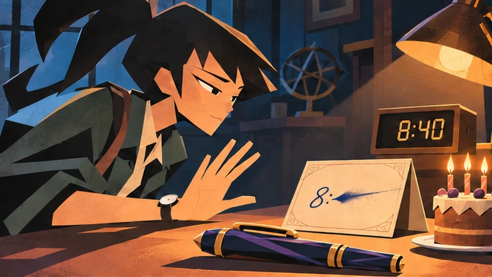

Evan is motionless beside the cake. His invitation reads “8:” followed by a blue smear.

At 8:40 p.m., a scream interrupts Echo’s surprise party. The guests find Evan, the fountain pen who was hosting, lying capped and motionless on his writing desk beside the cake. Under him is the invitation he was writing. The time trails off at “8:” and a blue smear crosses the fold.

“Nobody touch the card,” Simone says. Cole goes live and tells his viewers, “Simone knows who did it.” His regulars take his word for it. The pedants ask what proof she has. What his claim amounts to depends on which audience he’s addressing.

Small, glowing stones orbit Simone. Each holds up a belief by a thread of light. The stones show the claims she’s taking for granted. When one of those claims comes into doubt, its stone can crack and dissolve.

## 2. YYYY SOWATT asks why

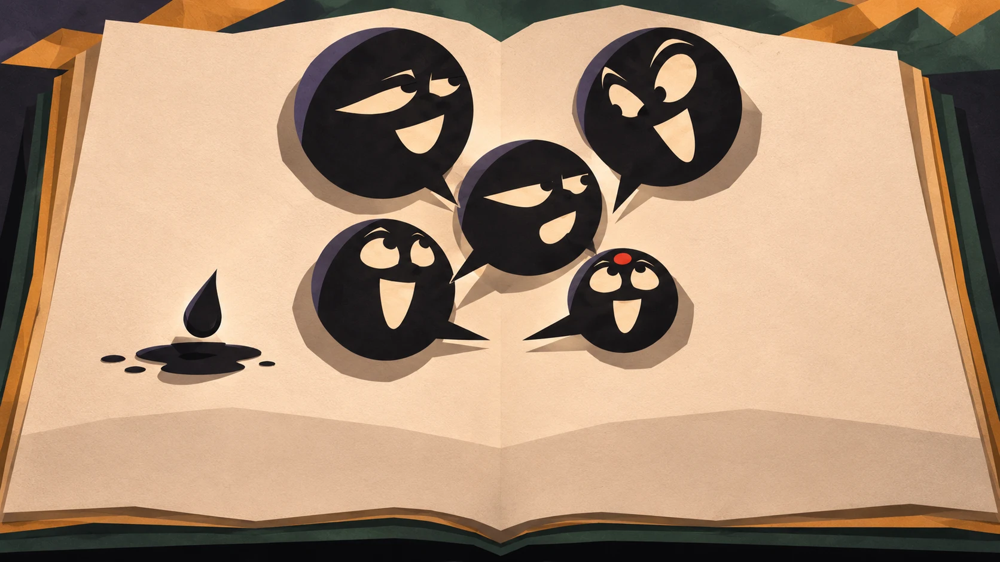

In the legend, five ink bubbles ask an archive keeper to explain how they know when a line was written.

Long ago, people told stories about a creature called YYYY SOWATT.

Archive keeper: Someone wrote this tonight.

Y: Why do you believe that?

Archive keeper: The ink’s still wet.

Y: Why does wet ink mean it was written tonight?

Archive keeper: Ink like this dries in minutes.

Y: Why think it dries that fast?

Archive keeper: I tested it yesterday.

Y: Why believe today’s ink is the same?

Archive keeper: It came from the same bottle.

SOWHAT: So what? How do you know the ink hasn’t changed?

Give it a reason, and it asks for another.

Some suspend judgment. Others keep asking for reasons, or look at how their beliefs support one another. Descartes finds a starting point in the thought that he exists while he is thinking.

There is no shortage of suspects. Cole’s selfie stick swung over the desk, Rae’s punch could snap a nib, and Milo had sticky hands. The Timetable Society had a grievance over an incorrect departure time. Echo has a claw and no alibi.

## 3. The case that never closes

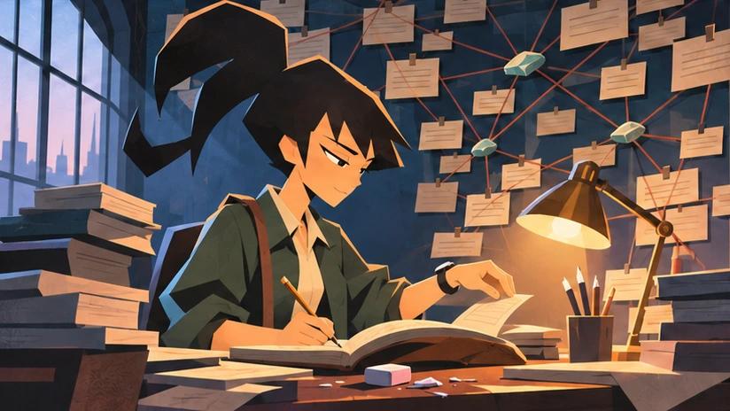

The Cartesian detective keeps checking until dawn. The moderate detective starts with what she saw.

Imagine Simone refusing to name a suspect until her evidence survives every possible doubt. She works through the night, checking one piece of evidence against the next. Dawn breaks and the case is still open.

The moderate detective starts with what she saw. Four stones hold up the investigation: Evan wrote the card, the card says eight, Simone read it correctly, and Evan is dead. Each claim could be questioned. For the moment, everyone is taking those four for granted.

## 4. How a stone forms

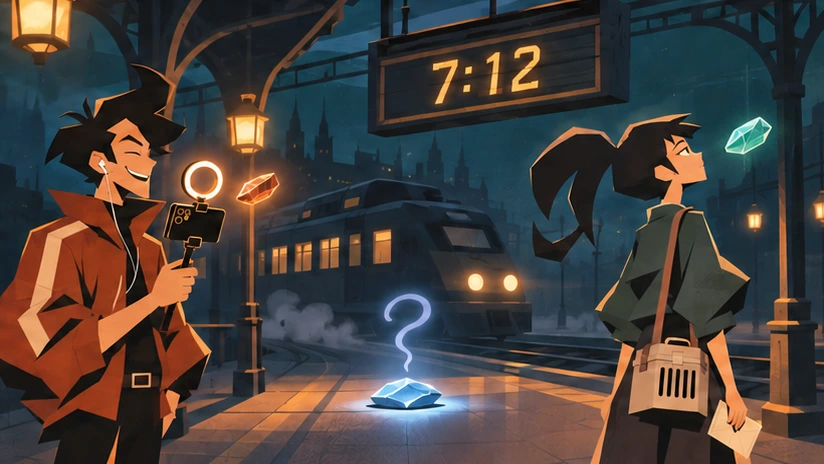

Cole’s chat lets a claim pass. A question brings its own hinge. Simone knows the departure time from the board.

On the platform, Cole’s viewers let a claim pass and a stone condenses. When someone types “source??” the claim needs more support. Which claims can serve as starting points depends on who’s there to object.

A different stone appears as soon as someone asks, “When did Evan die?” The question itself takes Evan’s death for granted. That assumption is the hinge the inquiry turns on.

Then Simone looks straight at the departure board. She knows the train leaves at 7:12 because she can see it. Here, what she knows supplies the foundation.

## 5. Back to 7:12

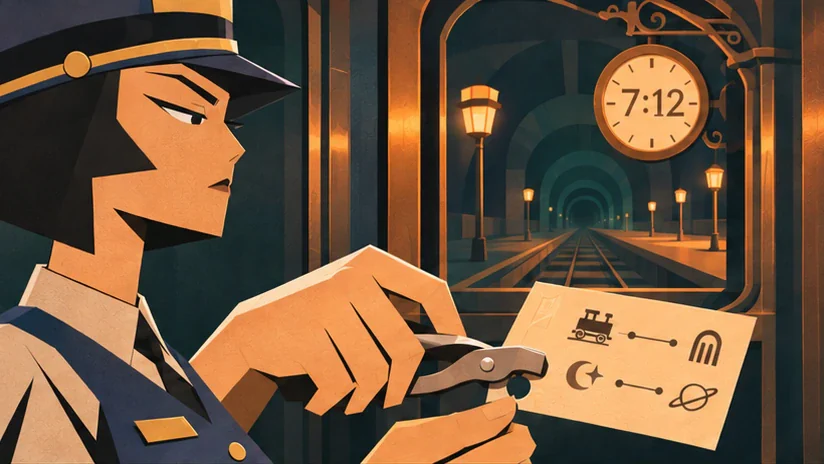

Rae punches a route and a version into the ticket. Each stop replays the same evening under different rules.

Rae punches two marks into the first ticket. One chooses how foundations form. The other chooses whose context matters. The Context Line pulls out, and at the next stop the clock is back at 7:12 p.m.

Each stop gives them the same evening, from the departure to the discovery at 8:40, with different rules for evidence. Simone leads when the subject’s situation matters. Cole takes over when the speaker’s words are at stake. Rae judges by her own standards, and Echo makes his commitments with a claw.

## 6. Simone’s community

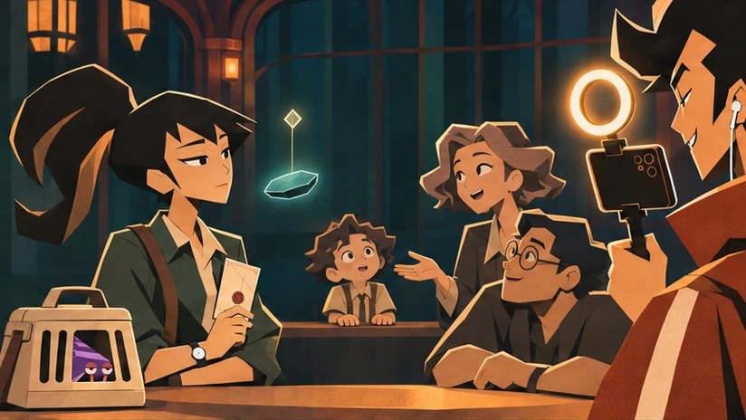

Evan’s friends let “Milo was alone with Evan” pass. A stone forms for Simone, and she accuses Milo.

At the first stop, Evan’s friends hear that Milo was alone with him. Nobody in the group challenges it. A stone forms for Simone, and she takes the claim as a starting point in accusing Milo.

Cole’s viewers cheer the accusation. “Your chat isn’t my community,” Simone tells him. In this replay, her own community sets the standards for what she can take for granted. Cole can gather as many replies as he likes without changing that.

## 7. Same sentence, two audiences

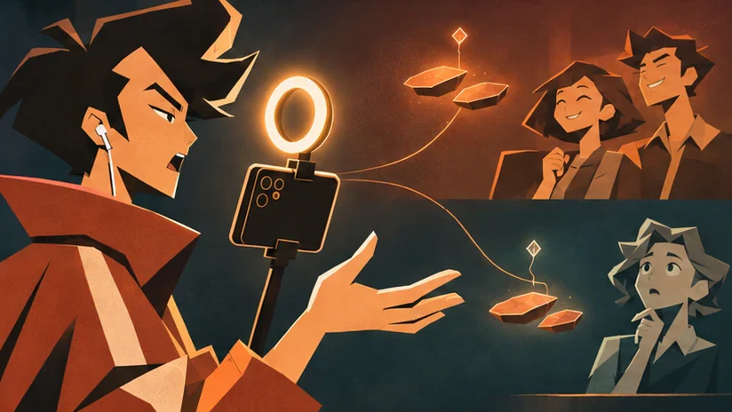

Cole’s friends and the pedants light different stones for the same words. The Retrograde raid accepts a bad reason.

In the next replay, Cole tells his regulars, “Simone is justified in accusing Milo.” Then he says the exact same thing to the pedants. Different stones light up for each audience. The sentence makes a different claim about what Simone’s grounds can withstand.

The Retrograde Car raids the stream. Its viewers let a bad reason pass and a stone forms anyway. Cole can see the group’s agreement take shape even though the reason is still bad.

## 8. Did Evan write it?

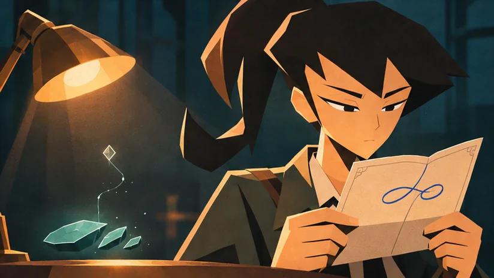

Simone studies the signature. Once authorship becomes her question, it can no longer serve as her starting point.

Simone lifts the invitation into the light and studies the blue loop in the signature. “Was the card even Evan’s?” Until then, she’d treated his authorship as settled. The moment she asks about it, that stone dissolves. Now she has to find grounds for a claim she had been using as a ground.

On Cole’s stream, changing the inquiry has another effect. When he switches from reconstructing the timeline to asking whether the scene was staged, the same line says something different. The question guiding his segment helps determine his claim.

## 9. Solid from one side

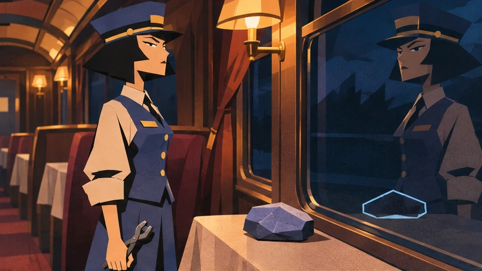

The evidence against Rae looks solid to the others. She sees the same stone as hollow.

The investigators turn on Rae. She arrived right after it happened, and her pliers could snap a nib. To the group, the evidence looks solid. When Rae examines the very same stone, she sees an empty outline.

Rae stamps the accusation “NOT VALID.” Both views belong to the same replay. The stone can count as solid by one assessor’s standards and hollow by another’s, with neither view given priority.

## 10. Echo keeps his claw tucked

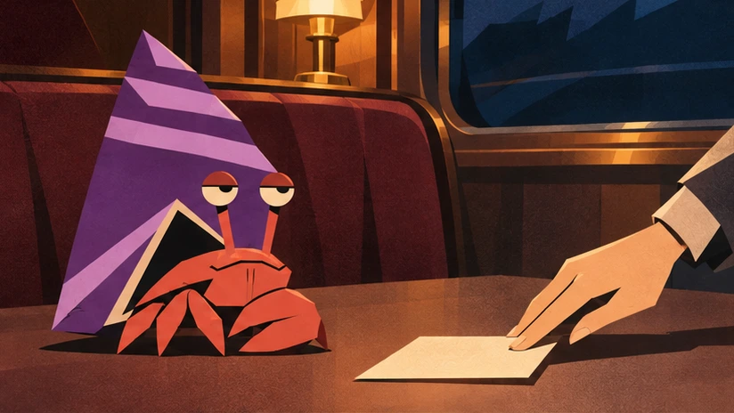

In this universe, commitment is a claw raise. Echo withholds it at every accusation, including the premise that Evan is dead.

A slip slides across the table toward Echo. In this replay the space around the investigators is empty. Taking a claim as foundational is expressed by raising a claw.

The others offer one accusation after another. Echo leaves his claw tucked every time. Even “Evan is dead,” the premise everyone has been using since the party, gets no claw raise from him.

## 11. Everybody’s a suspect

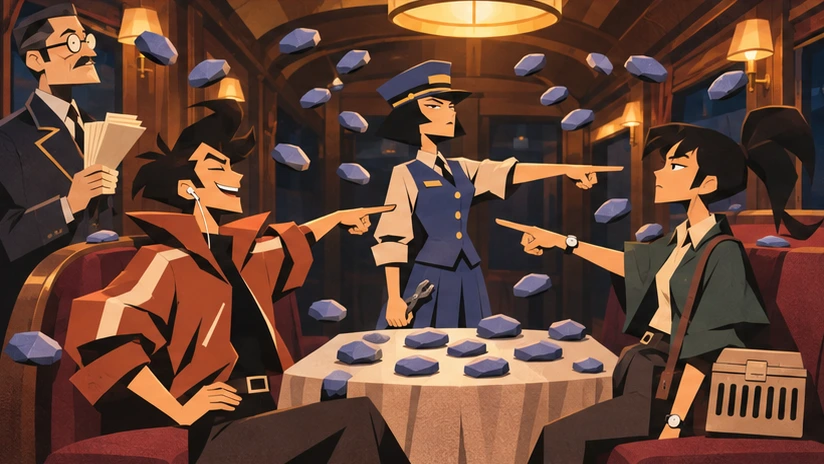

Every passing suspicion becomes a stone. The investigators accuse each other all at once.

At the next stop, every belief becomes a foundation as soon as someone holds it. A passing suspicion is enough. Stones crowd the dining car as the investigators take their own guesses as grounds for pointing at one another.

Everyone is arrested at once.

## 12. “Not valid.”

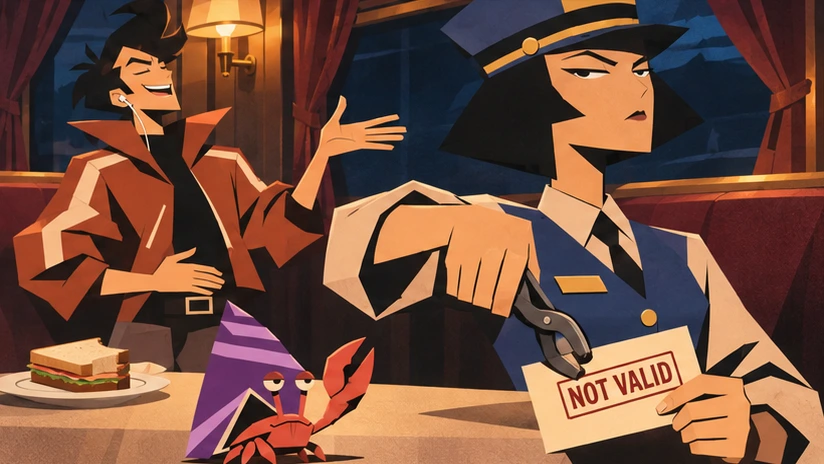

Cole says Simone is justified in accusing Milo. Rae answers with her punch, and Echo raises a claw.

The investigators compare notes in the dining car. “I’m starving,” says Cole. “I’m not,” says Rae. Each is talking about their own hunger, so both can be right.

Then Cole says, “Simone is justified in accusing Milo.” Rae punches the ticket. “Not valid.” Now it feels like a real disagreement. Relative to Rae’s standards the claim fails. Echo’s claw can express a commitment in response to her punch. The disagreement is still on the table when the train takes them home.

## 13. Simone’s stone flickers

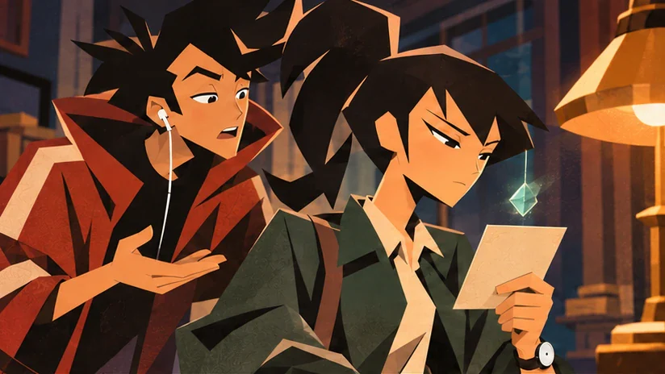

She can barely see the stone holding up 8:00. Doubting her grounds makes her doubt the time.

Back in their own universe, it’s 8:40 again. Cole asks Simone, “Are you justified in thinking you’re justified?” She looks for the stone that holds up her reading of 8:00. It flickers. As she becomes less sure what supports her reading, she becomes less sure of the time itself.

Normally, what Evan wrote would settle what Simone should believe about the time. She could read it and recognize her grounds. The hallway TV gives the wrong forecast in the background. Being able to see the evidence for this one claim gives her very little access to facts in general.

## 14. The ink gives them a time

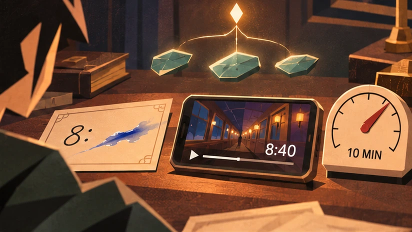

Evan’s ink dries in ten minutes. The still-wet smear and Cole’s 8:40 timestamp place Evan at the desk around 8:30.

Under the lamp, Simone still can’t read the digits after the eight. The stone for “Evan wrote 8:00” dissolves. Then she remembers Evan’s boast, delivered with a bow. His ink takes exactly ten minutes to dry.

Cole checks the stream archive. Its timestamp puts the discovery at 8:40, and the smear was still wet when the guests found Evan. Put those clues together and Evan was writing around 8:30.

New stones form from the drying time, the wet ink, and the timestamp. Simone can see the grounds for her revised timeline even with the exact time on the card unreadable.

## 15. “Is he actually dead?”

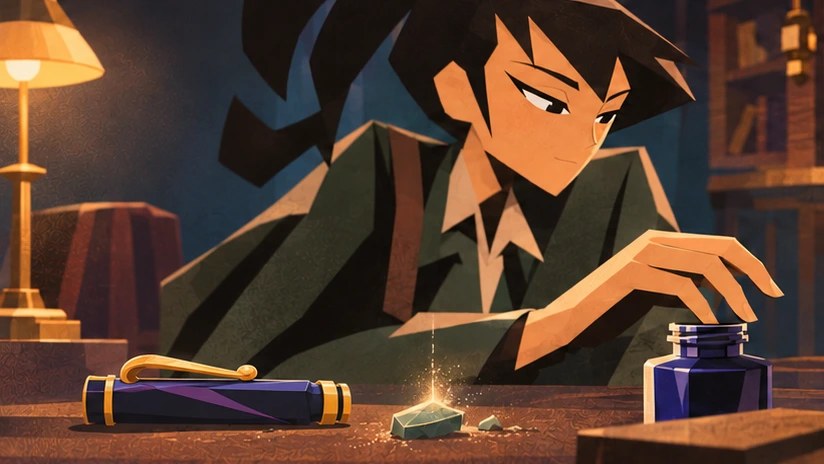

The new timeline clears the suspects. The thinning stroke suggests Evan ran dry. The stone holding up “Evan is dead” breaks.

The 8:30 timeline clears every suspect. None was near the desk then. Simone looks again at the stroke after the colon. It thins out mid-line, the way a pen runs dry while writing.

“Is he actually dead?” Every replay had started from the question of who killed Evan. Asking it had conjured a stone for “Evan is dead,” so the investigators had used his death as a starting point in every universe. Now that Simone asks about it directly, the stone cracks. She reaches for the ink bottle.

## 16. “You’re early.”

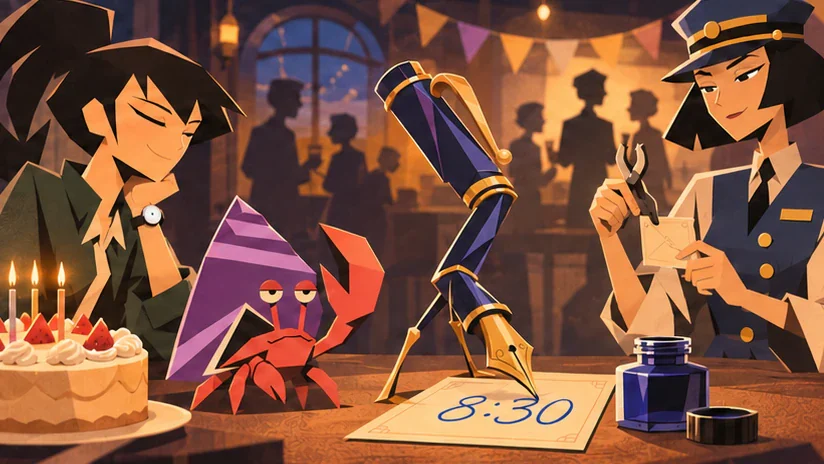

Simone refills Evan. He bows and writes 8:30. Echo clacks once and Rae punches the invitation: “Valid.”

Simone refills Evan. He gasps, straightens, and bows over the invitation. Beside the smear he writes a fresh, legible 8:30. “You’re early,” he says.

The guests yell “SURPRISE!” Echo raises his claw and clacks once. He never raised it for the claim that Evan was dead. Rae takes the invitation, punches it, and says, “Valid.” The corner of her mouth lifts for a frame.

The investigators had grounds to open a murder case. They solved it when Simone revisited the assumption that made it a murder case in the first place.
