# Until It Dries first illustrated reader

The thirteen-page edition before the expanded reader. [Original art and prompts](until-it-dries-art.md).

## 1. The Thaw

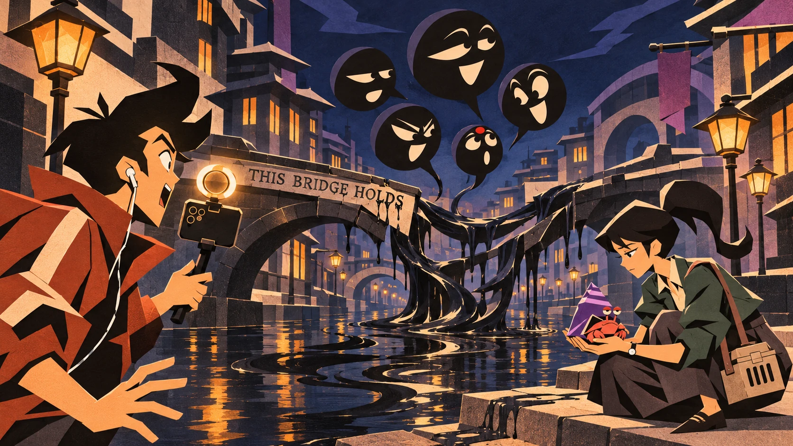

The words on Cole’s bridge turn back into ink.

Cole is halfway across the bridge, broadcasting to his regulars, when a bubble rises from the river. Four more follow it. The smallest has a red dot. “Why?”

The bridge is built from bars of dried ink. THIS BRIDGE HOLDS is pressed into its face. The letters start to run. By the time Cole scrambles back to the bank, the center span has slumped into the river. Simone scoops up Echo. Their way home is gone.

Across the canal, the Great Inkwell stands open. A claw-shaped crack runs through its seal.

## 2. The bridge will hold

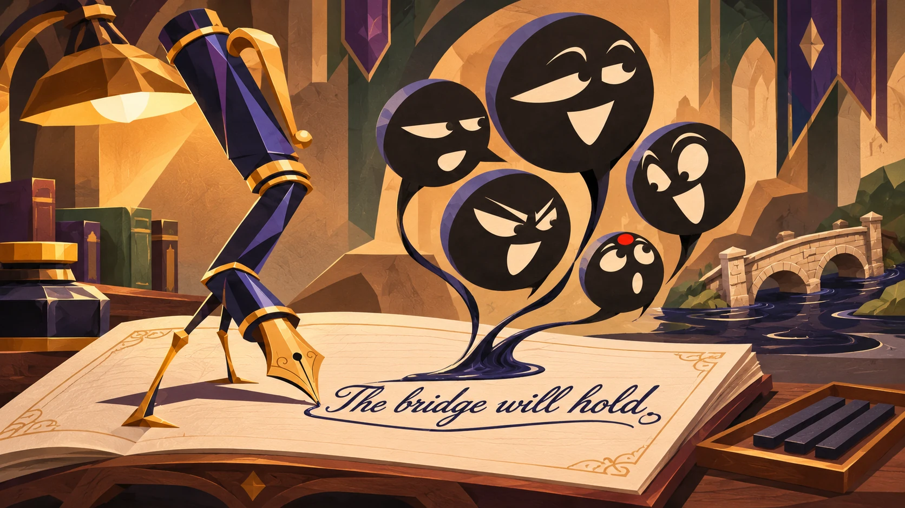

The legend begins with a sentence that never dries.

Long ago, every word in the world was written in ink. Left alone, ink dried in minutes. While someone was still asking about it, the ink stayed wet. Then someone spilled a question mark into the Great Inkwell. What grew there was called YYYY SOWATT.

Pen: “The bridge will hold.”
Y: Why believe it will hold?
Pen: I crossed it this morning.
Y: Why think this morning tells you about tonight?
Pen: Bridges don’t change overnight.

Y: Why believe they don’t?
Pen: This one never has.
Y: Why trust “never has”?
Pen: I’ve crossed it every day for forty years.
SOWHAT: So what? Every bridge holds until the day it doesn’t.

Her words never dried. Neither did the bridge.

## 3. Four responses

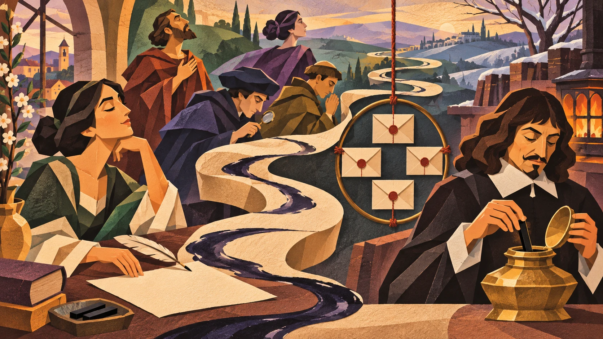

A laid-down quill, a scroll with no end, a ring of letters, and a single ink stick.

Some people stopped writing when they ran out of reasons. They were oddly calm. Others kept answering, and their still-wet scrolls rolled over the hills. Some pinned their letters in a ring, each vouching for the next. YYYY SOWATT swam around the circle.

Legend says Descartes found one sentence that stayed dry through every question. He could doubt what he saw, yet in doubting he was thinking. The ink bearing “I think” hardened into a stick. He used it to seal the five voices in the Great Inkwell.

## 4. The Great Inkwell

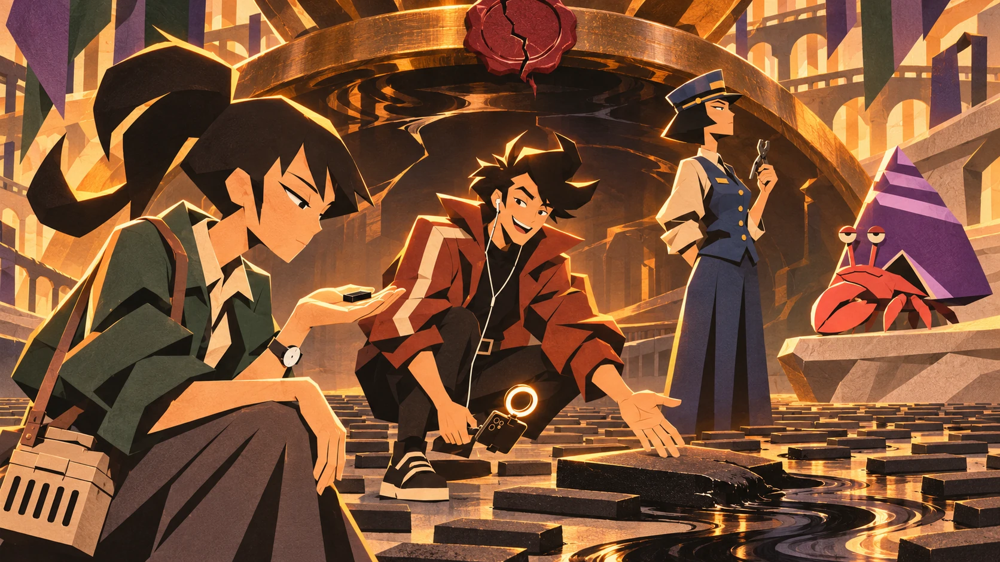

The stick that sealed the Inkwell is the size of a grain of rice.

The four go to the Great Inkwell to reseal it. Descartes’s stick is intact. It’s the size of a grain of rice. “I think” gives the crew somewhere to start, but it can’t tell them whether a bridge holds. Cole tries the more ordinary “I can see the street’s solid.” SOWATT asks, “Why stop there?” The street softens.

The seal had kept the questions out. The city had stood on thousands of ordinary sentences that happened to go unquestioned. A dry stick can go wet again. You can also grind it into fresh ink to write a conclusion that depends on it.

They look for three ways a claim can stay dry. An audience can let it stand. A question can hold other things fixed, even when a Y asks it. And seeing what’s in front of them can give them a place to start.

## 5. Simone’s draft

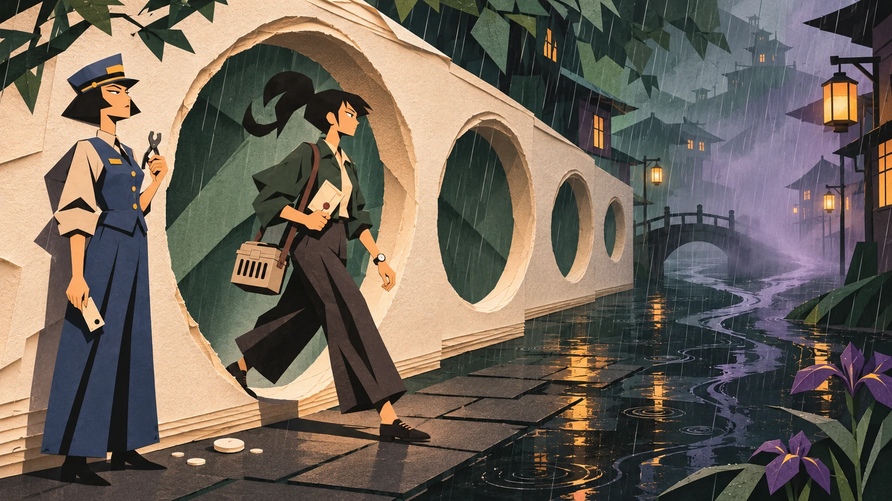

Rae punches through the page, and Simone steps onto a street that holds for now.

Rae punches four holes through the page. Each opens onto a draft of the same city with a different rule for whose questions keep the ink wet.

Simone steps through to find a dry path home. As long as she’s asking “Which way home?”, the street under her stays dry. Then she asks “Is this even my street?” and it softens at her feet.

Simone is the subject. What she can take for granted depends on the inquiry she’s pursuing.

## 6. Cole’s draft

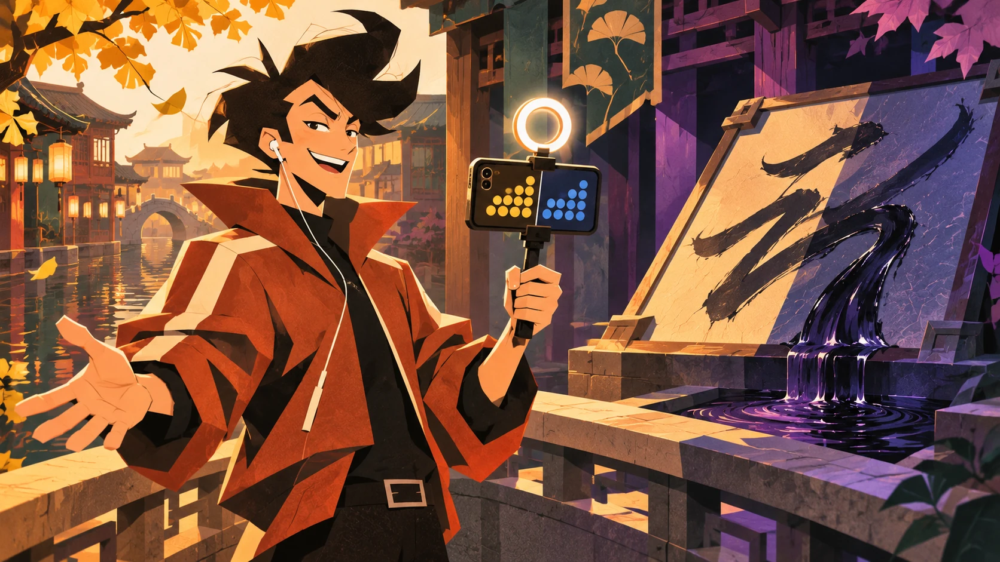

One line on the stream lands differently with two audiences.

Cole broadcasts which bridges are safe. “This bridge holds,” he tells his regulars. They let it pass and the ink dries. He says the same words to the Timetable Society. They ask for proof and the ink stays wet.

Cole is the speaker. The audience changes the claim he makes with the same words. Then the Retrograde crowd raids his stream, and a claim about horoscopes dries because nobody in that chat challenges it.

## 7. Rae’s draft

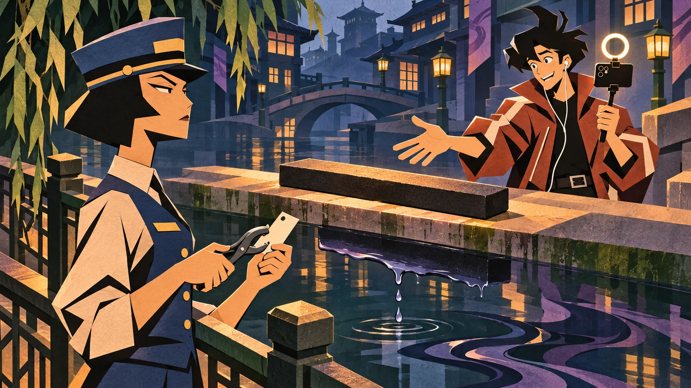

Rae judges the bridge from her side of the canal.

Rae’s job is to certify the bridges. The ink Cole takes to be dry looks wet from where she stands. He says, “This bridge holds.” Rae studies the bridge, then punches her ticket. “Not valid.”

Rae is the assessor. The same claim can count as true from one assessor’s context and false from another’s. To Cole, it sounds like a real disagreement.

## 8. Echo’s draft

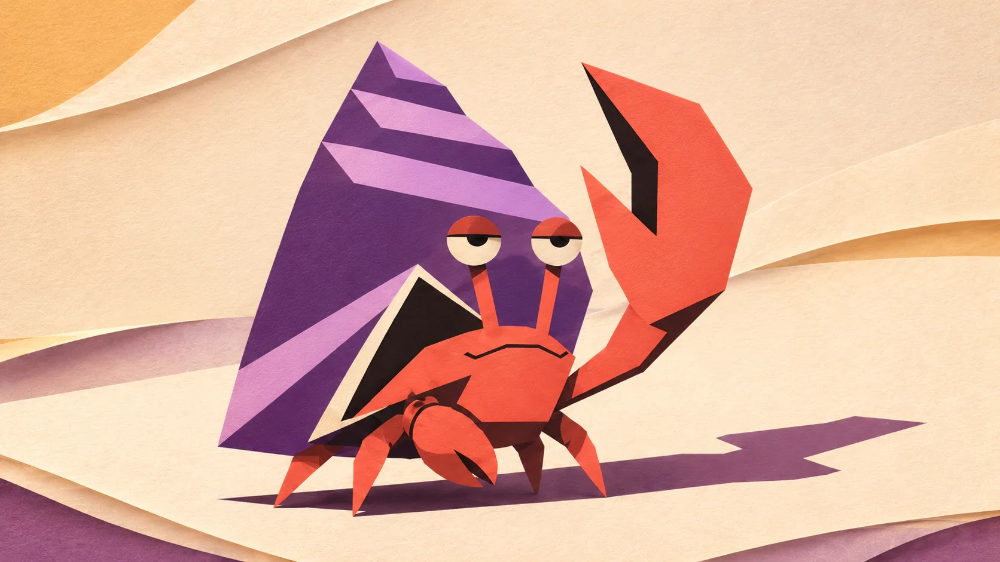

Echo answers with one raised claw.

Echo’s draft has only the claw. A raised claw expresses a commitment to taking a claim as a starting point. When he keeps the claw tucked, he withholds that commitment.

Cole’s words and Rae’s verdict are still in the air. Echo raises his claw. Rae’s punch and Echo’s gesture make the disagreement visible.

## 9. The Dry Draft

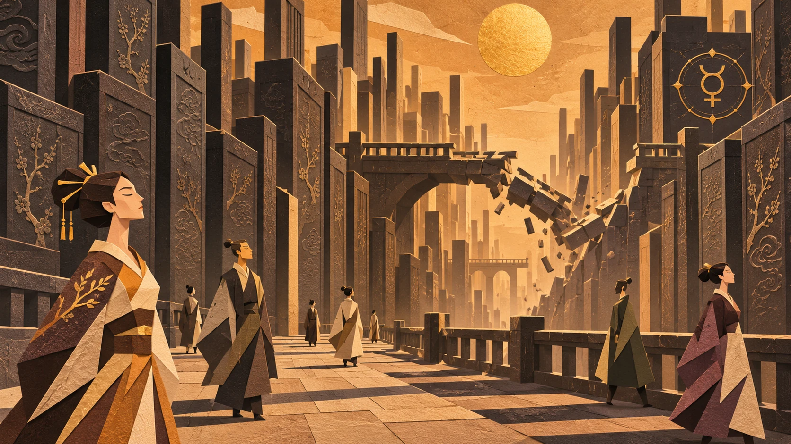

In this draft, even a bad claim dries forever.

The crew looks for a way to destroy YYYY SOWATT and steps into a draft where someone already did. Everything stays dry. The city gleams. Its residents stand on bars bearing claims like “Mercury retrograde weakens bridges.”

Even when a claim turns out to be wrong, nobody can reopen the question. They watch a bridge decay while the words holding it up stay perfectly dry. The crew starts looking for a way home with the questions still in the world.

## 10. The map runs

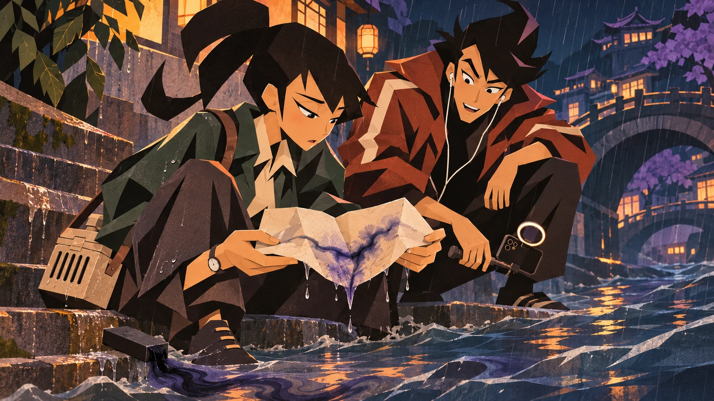

As Simone doubts her grounds, the ink under her boots softens.

The river rises. Cole asks Simone, “Are you justified in thinking you’re justified?” She looks down. The stick under her feet is softening. Doubt about her grounds has reached the belief she was relying on.

Her map said “Home is across the Red Bridge.” Its words fixed her grounds for trusting that route while she could still read them. Now the ink has run. If the route still depends on those unreadable words, she can’t tell which way she should go.

## 11. One step at a time

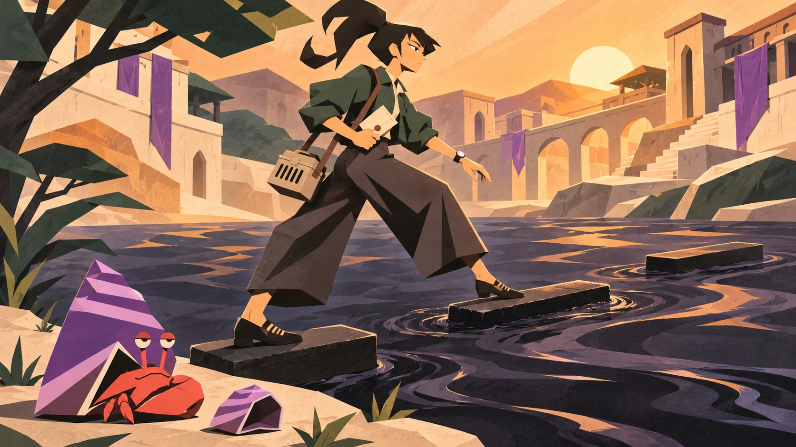

Echo changes shells. Simone finds ground for her next step.

Echo climbs out of his shell and into a new one. Simone watches him and shifts to what she can know where she is now. She hears the river, checks Cole’s live view, and feels her own footing.

Dry ground forms one step ahead. She puts her weight on it and takes the next step. What she can rely on moves with her.

## 12. The claw-shaped crack

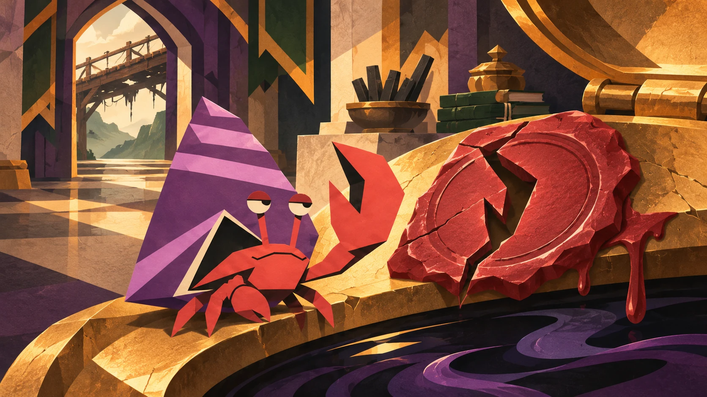

The mark in the seal fits Echo’s claw.

Echo broke the seal. The bridge was already rotting underneath the words “This bridge holds.” Nobody could bring themselves to question the inscription. Echo had kept his claw tucked for it the whole time.

He let the questions back in before anyone else trusted the failing bridge. Simone remembers what SOWHAT said in the legend. “Every bridge holds until the day it doesn’t.”

## 13. Valid

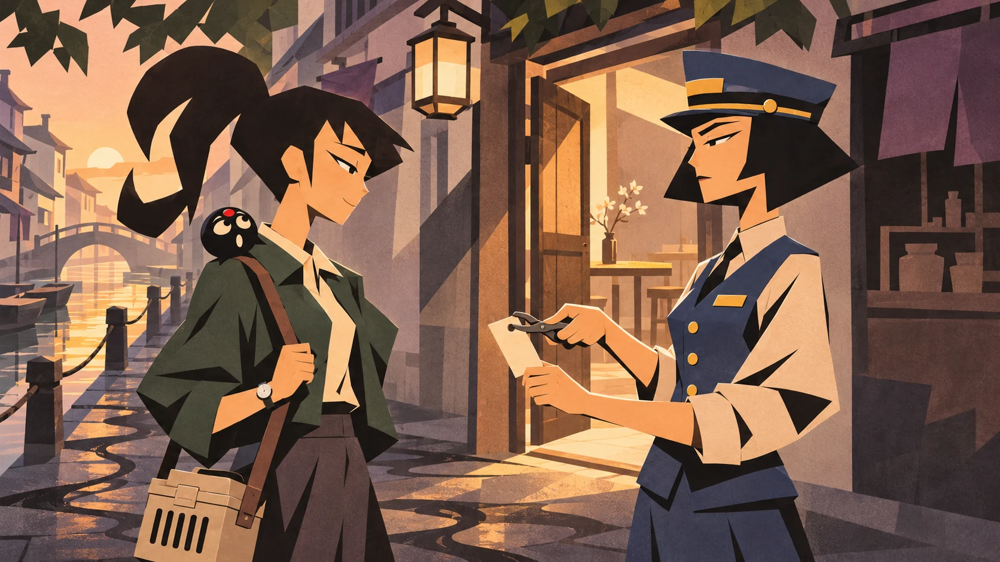

SOWHAT comes home on Simone’s shoulder.

At the far bank, YYYY SOWATT shrinks down to its smallest voice. SOWHAT settles on Simone’s shoulder. There’s room for a question when it matters.

Rae punches Simone’s ticket. “Valid.” The corner of her mouth lifts for one frame.
